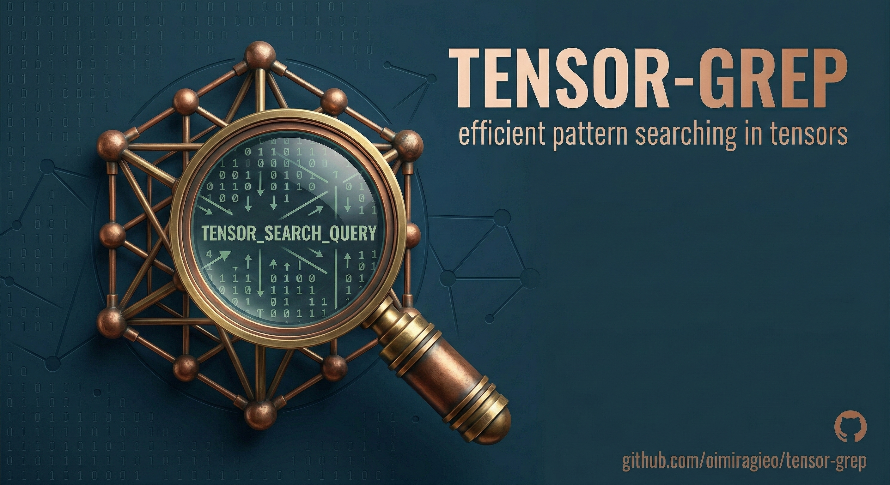

<!--
release_docs_current_tag: v2.0.0
-->

<div align="center">
  
</div>

# tensor-grep

[](https://pypi.org/project/tensor-grep/)
[](https://github.com/oimiragieo/tensor-grep/actions/workflows/ci.yml)
[](LICENSE)

**Find the code. Understand the change.**

`tensor-grep` (`tg`) is a local-first code search, symbol-navigation, and AI context CLI. It combines regex and structural AST search with repository orientation, caller/blast-radius analysis, diff-impact slicing, rollback checkpoints, and an MCP server—with **zero telemetry** and **no API key required** for core workflows.

[Get started](docs/getting-started.md) · [Installation](docs/installation.md) · [Upgrading (v1.x to v2.0)](docs/migration-v2.md) · [How it works](docs/architecture.md) · [Releases](https://github.com/oimiragieo/tensor-grep/releases)

## 30-second quickstart

With Python 3.11+ on **Windows, macOS, and Linux** (or the managed native installer in [docs/installation.md](docs/installation.md)):

```bash
python -m pip install tensor-grep
tg --version
```

From any repository:

```bash
# 1. Find literal text or regex matches with line numbers
tg search -F -n "TODO" src

# 2. Orient yourself in an unfamiliar codebase
tg orient src

# 3. Trace callers and prepare an edit-readiness capsule (add --json or --json --compact)
tg callers src create_invoice --json
tg prepare src "add invoice tax validation" --json --compact

# 4. Inspect git diff blast radius before committing
tg diff-impact . --json
```

Commands default to concise human-readable text when `--json` is omitted; pass `--json` for machine output or `--json --compact` for a bounded `<= 4,000`-byte JSON payload.

## 12-command core workflow (`tg --help` vs `tg --help-all`)

`tg --help` highlights the **12 core workflow commands** so humans and agents can start without noise. Run `tg --help-all` for the complete command catalog.

| Stage | Core commands | What it gives you |
|---|---|---|
| Search & structure | `search`, `find`, `run`, `scan` | Regex/literal search (`--index`, `--rank`), local hybrid BM25+RRF (`find --hybrid`), structural AST patterns (`run`), and bounded AST rulesets (`scan`) |
| Understand & trace | `orient`, `defs`, `callers`, `blast-radius` | Central files and entry points (`orient`), symbol definitions (`defs`), call sites (`callers`), and transitive file/test impact (`blast-radius`) |
| Prepare, edit & verify | `prepare`, `diff-impact`, `checkpoint` | One-call edit-readiness capsule (`prepare`), git diff blast radius + change slice (`diff-impact`), and scoped rollback snapshots (`checkpoint`) |
| Connect assistants | `mcp` | 15-tool compact default MCP server (`< 12 KB` `tools/list`, `tg_batch` step pipelines; `TG_MCP_LEGACY_TOOLS=1` for all 61 legacy tools) |

For AST structural search and rulesets via PyPI, install `python -m pip install "tensor-grep[ast,scan]"` (the managed native binary supports `tg run` directly). In PowerShell, wrap patterns containing `$VALUE` in single quotes:

```bash
tg run -p 'print($VALUE)' --lang python src
```

## Why `tg` vs `rg` + `ast-grep` + IDE

- **`rg` (ripgrep)** is the cold exact-text search baseline. `tg` does not replace `rg`; it routes compatible cold text searches through `rg` or its native CPU engine, and adds warm trigram indexing (`tg search --index`), symbol graphs, and bounded AI context on top.
- **`ast-grep` (`sg`)** has the broader structural-rule surface. `tg run` and `tg scan` expose a validated AST search/rewrite slice alongside symbol navigation, diff impact, and checkpoints in one CLI.
- **IDEs** hold rich semantic state interactively, but scripts, CI gates, and coding assistants need headless, deterministic, token-budgeted CLI/MCP outputs (`--json`, `--json --compact`, `tg_batch`, and `tg review-bundle verify --require-change-slice`) without GUI startup or cloud telemetry.
- **Zero-telemetry, local-first**: Core search, indexing (`.tg_cache/`), symbol graphs, sessions, and checkpoints run 100% locally with no API key and no outbound telemetry.

## Benchmark & verification surfaces

Performance and accuracy claims in `tensor-grep` are **benchmark-governed** and workload-specific. Rather than quoting cherry-picked numbers, each surface has a reproducible harness in `benchmarks/` documented in [docs/benchmarks.md](docs/benchmarks.md) and [docs/tool_comparison.md](docs/tool_comparison.md):

| Surface | Reproducible script | Verified behavior / contract |
|---|---|---|
| Text search (`rg` vs native CPU vs `TrigramIndex`) | `benchmarks/run_benchmarks.py`, `benchmarks/run_hot_query_benchmarks.py` | Cold exact-text baseline is `rg`; warm trigram indexes (`.tg_cache/index_v1/*.tg_index`) report `routing_reason: "index-accelerated"` (`tg search --index`) |
| Agent localization & edit loop | `benchmarks/run_repo_retrieval_benchmarks.py`, `benchmarks/run_agent_workflow_benchmarks.py` | `tg prepare`, `tg agent` (context capsule), and `tg orient --compact` bound JSON output to `<= 4,000` bytes and reuse warm `.tg_cache/` views (`manifest_v1.json`, `symbols_v1/`, `graph_v1/tdad_tests.sqlite3`) |
| MCP schema & pipeline budget | `tests/unit/test_mcp_compact_parity.py` | Default `tg mcp` exposes 15 compact tools (`< 12 KB` `tools/list`, vs 61 with `TG_MCP_LEGACY_TOOLS=1`) and `tg_batch` (`$prev` / `$steps[i]`) |
| Security & AST rulesets (`tg scan`) | `benchmarks/run_ast_benchmarks.py` | Built-in rulesets (e.g., `secrets`) via `tensor-grep[scan]`; fails closed when `ast-grep` is absent and discloses `partial` / `partial_reason` |
| Native GPU (experimental) | `benchmarks/run_gpu_native_benchmarks.py` | Explicit `--gpu-device-ids` only; never inferred from fallback/sidecar rows ([docs/gpu_crossover.md](docs/gpu_crossover.md)) |

Bounded scans can return partial results. Confidence scores and caller graphs are evidence to review, not proof that a change is safe or that a symbol is unused.

## Installation & platform channels

Windows (x64), macOS (x64 / Apple Silicon), and Linux (x64 / ARM64) installation options are documented in [docs/installation.md](docs/installation.md) and the [support matrix](docs/SUPPORT_MATRIX.md). npm, Homebrew, and Winget manifests exist in the repository but are not published to their registries yet.

## Canonical docs

| Guide | Purpose |
|---|---|
| [First search](docs/getting-started.md) | Sample project, 12-command core workflow, and glossary |
| [Installation](docs/installation.md) | Install, verify, and troubleshoot the launcher |
| [Upgrading (v1.x to v2.0)](docs/migration-v2.md) | Step-by-step migration guide from `v1.x` to `v2.0.0` |
| [Architecture](docs/architecture.md) | Rust `cli_app/` + `native_search/`, Python `cli/` modules, and `.tg_cache/` |
| [docs/harness_api.md](docs/harness_api.md) | Machine-readable CLI and MCP contracts (15-tool compact default + `tg_batch`) |
| [docs/harness_cookbook.md](docs/harness_cookbook.md) | End-to-end CLI, MCP, and diff-impact automation recipes |
| [docs/runbooks/cache-management.md](docs/runbooks/cache-management.md) | Unified `.tg_cache/` layout, sessions, and rollback checkpoints |
| [docs/enterprise_review_bundle_ci.md](docs/enterprise_review_bundle_ci.md) | Signed evidence receipts and `--require-change-slice` CI gates |
| [docs/routing_policy.md](docs/routing_policy.md) | How execution paths are selected |
| [docs/benchmarks.md](docs/benchmarks.md) | Accepted measurements and regression checks |
| [docs/tool_comparison.md](docs/tool_comparison.md) | Workload and language-coverage comparisons |
| [docs/gpu_crossover.md](docs/gpu_crossover.md) | GPU measurements and current limits |
| [docs/SUPPORT_MATRIX.md](docs/SUPPORT_MATRIX.md) | Platforms, runtimes, and delivery channels |
| [docs/CONTRACTS.md](docs/CONTRACTS.md) | Compatibility and output guarantees |
| [docs/CI_PIPELINE.md](docs/CI_PIPELINE.md) | Testing, releases, and dependency maintenance |
| [docs/HOTFIX_PROCEDURE.md](docs/HOTFIX_PROCEDURE.md) | Patch and rollback procedures |
| [docs/EXPERIMENTAL.md](docs/EXPERIMENTAL.md) | Opt-in GPU, dense retrieval, and experimental surfaces |

## Contribute and get help

[Report a bug](https://github.com/oimiragieo/tensor-grep/issues/new?template=bug_report.yml),
[request a feature](https://github.com/oimiragieo/tensor-grep/issues/new?template=feature_request.yml),
or [ask a question](https://github.com/oimiragieo/tensor-grep/issues/new?template=question.yml).
Include the command, `tg --version`, your platform, and a small reproducible example.

See [CONTRIBUTING.md](CONTRIBUTING.md) for development and review conventions, and
[SECURITY.md](SECURITY.md) for private vulnerability reporting.

## Future Work

Ongoing work focuses on retrieval quality, cross-file navigation, larger repositories,
and integrations. Experimental features graduate through measured results and compatibility
checks. See the [experimental-feature guide](docs/EXPERIMENTAL.md) for current boundaries
and [GitHub issues](https://github.com/oimiragieo/tensor-grep/issues) for discussion.

## License

Apache-2.0. See [LICENSE](LICENSE). Related project: [gotcontext.ai](https://gotcontext.ai).

Optional runtime dependency security and verification: [security floors](docs/optional-runtime-security.md).
