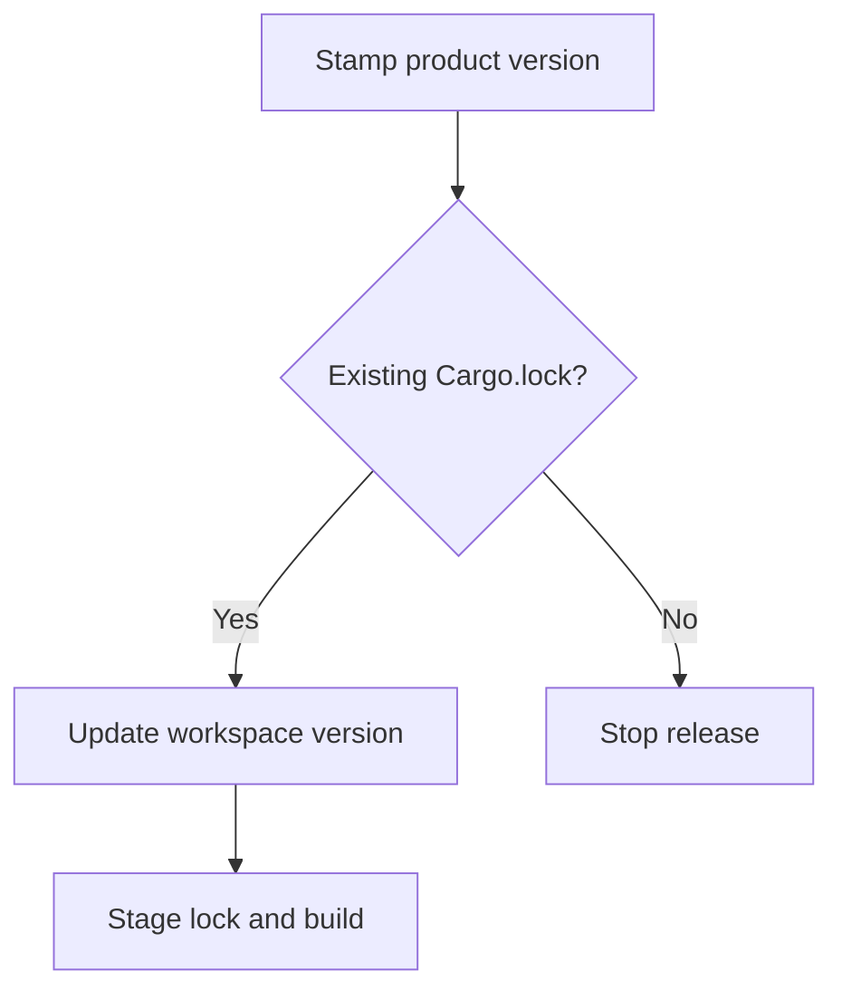

# CI Pipeline

`tensor-grep` treats CI as part of the product contract, not a best-effort test runner. If you change workflow behavior, release behavior, package-manager behavior, or supply-chain automation, update the validator-backed tests in `scripts/validate_release_assets.py` and `tests/unit/test_release_assets_validation_*.py`.

Release/package parity validation now includes the editable `tensor-grep` version recorded in `uv.lock`, not just `pyproject.toml`, `rust_core/Cargo.toml`, and `npm/package.json`.
The semantic-release build command must refresh that lock entry with `uv lock --upgrade-package tensor-grep` and stage `uv.lock` before building artifacts.

## Workflow Overview

### `ci.yml`

Runs on pushes to `main`, pull requests targeting `main`, and a weekly schedule.

Primary responsibilities:

- `repo-hygiene`: isolated source release-asset validation before the Rust build
- `release-readiness`: strict docs build plus final workflow/package-manager validator checks
- `Formatting & Linting`: Rust formatting/clippy plus Python Ruff and mypy
- `test-python`: cross-platform Python test matrix
- `test-rust-core`: cross-platform Rust test matrix
- `search-golden-parity`: Windows routing parity guard
- `native-build-smoke`: native binary smoke tests across platforms, including both `macos-latest` (arm64) and `macos-15-intel` (x86_64) so PR CI matches the Intel release asset built for `tg-macos-amd64-cpu`
- `package-manager-readiness`: Homebrew/Winget/package-manager bundle validation
- `benchmark-regression`: blocking same-runner base-vs-head regression gate plus accepted-baseline drift reporting
- `Semantic Release`: semantic-release on `main`
- `build-release-native-assets`: builds release-native CPU front doors from the semantic-release tag when `steps.release.outputs.released == 'true'`; the macOS amd64 asset is built on an Intel macOS runner label. The default release-native asset profile remains CPU-only `native-frontdoor`. Setting repository variable `TENSOR_GREP_RELEASE_NATIVE_ASSET_PROFILE=native-frontdoor-gpu` additionally enables opt-in Linux/Windows NVIDIA front-door assets built with CUDA features.
- `publish-github-release-assets`: uploads and verifies GitHub release assets for the semantic-release tag when `steps.release.outputs.released == 'true'`
- PyPI build, validation, and publish jobs when semantic-release emits a new version. Wheel and sdist jobs prefetch Rust dependencies with a longer Cargo retry window before `maturin` so transient crates.io DNS failures do not prematurely cancel publication.

The `agent-capsule-hardcases` readiness check runs the full 22-test module with a 240-second subprocess ceiling on Linux and Windows. That budget covers three live-checkout capsules at their 60-second CLI deadline plus a 60-second startup/fixture margin; an inner deadline skip remains visible and does not mean the case passed.

The `test-gpu-linux` cuDF lane runs the full Python suite, including linked AST-rule tests. It installs the pinned ast-grep CLI (`0.41.1`) and verifies that the Python wrapper can find it before pytest starts. Linked test cases with an empty pattern inherit the rule's pattern from `ruleId`; the wrapper interprets `ERROR` as ast-grep literal matching, while tree-sitter treats it as a node query and can match an `ERROR` node in malformed source. The lane runs on a CPU-only GitHub runner, so it verifies dependency and fallback compatibility rather than physical GPU execution.

To reproduce the bounded checks locally, install the `.[dev,ast]` extra and ast-grep `0.41.1`, then run:

```bash
uv run --no-sync python -c "import subprocess, sys, tempfile; p = tempfile.TemporaryDirectory(prefix='tg-ast-'); subprocess.run([sys.executable, '-m', 'pytest', '-q', 'tests/unit/test_ast_workflows.py', 'tests/unit/test_release_assets_validation_ci_release_gates.py', '-k', 'LinkedRule_EmptyCasePattern or AstSelection_WrapperAbsent or NativeAstQuery_ErrorNodeCounts or CiAstLane_FullAstSuite', '--basetemp', p.name], timeout=180, check=True)"
```

The wrapper-present case skips with an explicit reason when the optional CLI is absent; the wrapper-absent case forces only wrapper availability off and checks the real tree-sitter behavior on valid `ERROR` and malformed `ERROR (` snippets.

Release behavior:

- Conventional commit subjects drive semantic-release intent.
- `feat:` => minor
- `fix:` / `perf:` => patch
- `feat!:` / `fix!:` => major
- `docs:` / `test:` / `ci:` / `chore:` / `build:` => no package release
- A branch push or open PR starts PR CI only. It is not a release, not a released version, and not complete release state.
- Release versioning starts only after a release-bearing PR is squash-merged to `main`, because semantic-release reads the final `main` commit subject.
- Release completion requires main CI and semantic-release complete successfully, GitHub release native asset upload/verification passing for the semantic-release tag, `publish-success-gate` passing when publish is required, `git fetch origin main --tags`, local `main` fast-forwarded to the release commit, and PyPI/public installer availability verified when the install/update path changed.

#### Preserving reviewed Rust dependencies

A version-only release must not silently select newer third-party dependencies after
the main test matrix. Treat the lockfile as a sealed shipping manifest: update the product
label while keeping the inspected contents. Customers receive the reviewed dependency set.



| Component | Plain-English Analogy | Core Responsibility |
| --- | --- | --- |
| Cargo.lock | Sealed shipping manifest | Preserve dependency versions and source revisions |
| Workspace update | Product label change | Advance workspace versions during release stamping |

The semantic-release command in [pyproject.toml](/pyproject.toml) first requires
`rust_core/Cargo.lock`, then runs `cargo update --workspace --manifest-path rust_core/Cargo.toml`
before staging it. Missing locks stop the chain before staging Cargo.lock or building artifacts.
Intentional dependency upgrades belong in separately reviewed changes. See the
[Cargo command contract](https://doc.rust-lang.org/cargo/commands/cargo-update.html).

Run `uv run --no-sync pytest tests/unit/test_release_cargo_lock_preservation.py` under an
external timeout. Its local-Git fixture advances an upstream revision, stamps the workspace,
and executes only the actual configured lock step: expect the product version to advance,
existing dependency records to stay identical, and missing-lock regeneration to fail.
It performs no compilation or external dependency download. CI verifies the supported
platforms; inspect the next natural release diff for unexpected third-party changes.
Rollback is a normal revert of the configuration, validator and tests together, restoring
the previous regeneration behavior and its dependency-drift risk.

| Spec ID | Behavior | CL # | File Link | Unit Test |
| --- | --- | --- | --- | --- |
| REL-LOCK-01 | Preserve existing dependency records | REL-LOCK-1 | [tests](/tests/unit/test_release_cargo_lock_preservation.py) | `test_ReleaseLock_VersionStamp_PreservesExistingDependencyRecords` |
| REL-LOCK-02 | Refuse missing lock | REL-LOCK-1 | [configuration](/pyproject.toml) | `test_ReleaseLock_MissingLock_RefusesRegeneration` |
| REL-LOCK-03 | Reject regeneration configuration | REL-LOCK-1 | [validator](/scripts/_release_assets_checks/docs_and_manifest_checks.py) | `test_Validator_LockRegeneration_RejectsDependencyDrift` |

Benchmark behavior:

- Pull requests benchmark the candidate checkout and the PR base revision in the same runner job; the explicit base-vs-head comparison is the blocking regression gate.
- Pushes to `main` benchmark the current checkout and `${{ github.event.before }}` in the same runner job; that explicit comparison is the blocking regression gate before semantic-release.
- Scheduled runs keep accepted-baseline drift reporting and summary generation, but do not block on a synthetic base-vs-head comparison.
- Accepted baseline JSONs remain the public benchmark truth surface, but drift against them is reported separately from the release-blocking same-runner comparison.

#### Reading test timing

The existing Python test matrix prints its 30 slowest reported durations of at least one second. Timing output does not change collection, markers, failure policy or platform coverage. Compare naturally occurring completed runs on the same OS, Python version and test population; a single run is not a performance baseline.

Before Cargo Test, both Rust steps explicitly select matrix.rust_channel. The existing provenance step prints rustc, Cargo and active-toolchain identities from rust_core to establish the tested compiler. The crate pin still governs ordinary local and production invocations without an override. Selecting a newer compiler may change build and test time; this change preserves the job population, not a guaranteed billed duration.

Use the timings to investigate expensive fixtures, subprocess startup and waits before adding workers or removing tests. Distinguish test time from installation/build time and summed job elapsed time from billed usage. This instrumentation adds no jobs, report uploads, dependencies or paid runners.

### `release.yml`

Manual/backfill release artifact pipeline, dispatched via `workflow_dispatch` TARGETING a published tag ref (`gh workflow run release.yml --ref vX.Y.Z`; `GITHUB_REF` then resolves to that tag). It is NOT triggered by a tag push, so a manually-pushed `v*` tag can no longer bypass semantic-release to auto-publish npm/assets. Do not rely on it for the normal semantic-release path. The authoritative release-bearing path is now `ci.yml` on `main`: semantic-release creates the tag/release, main CI checks the action's `released` output, builds release-native CPU front-door assets from that tag, uploads them to the GitHub release, verifies checksum/package-manager coverage, then allows PyPI publish and `publish-success-gate` to complete.

### `benchmark.yml` (Benchmarks)

Runs the standalone benchmark workflow on a schedule and via manual dispatch.

Primary responsibilities:

- run `benchmarks/run_benchmarks.py` and `benchmarks/run_ast_benchmarks.py`
- provision AST benchmark prerequisites before the suite: `ripgrep`, `hyperfine`, `ast-grep`, and a freshly built native release `tg` binary
- optionally run `benchmarks/run_gpu_benchmarks.py` on manual dispatch
- perform the OS-baseline regression check when a stored baseline exists
- publish the benchmark markdown summary and artifacts

This workflow is not the release-blocking same-runner regression gate from `ci.yml`; it is the canonical scheduled/manual benchmark automation surface and should stay documented and validator-backed.

### `public-gpu-proof.yml`

Manual-only workflow for public managed NVIDIA GPU promotion proof. It is intentionally not part of
normal PR, push, or scheduled CI because it requires a fixed GPU-capable runner label:
`self-hosted`, `linux`, `x64`, `gpu`, and `tensor-grep-public-gpu-proof`. The job targets
`environment: public-gpu-proof` so repository maintainers can require explicit approval before
dispatching unattended promotion proof on the self-hosted GPU runner.

The workflow validates a `vX.Y.Z` release tag, checks out that tag, verifies GitHub release assets
with `--expected-profile native-frontdoor-gpu`, installs the requested public release with
`TENSOR_GREP_NATIVE_FRONTDOOR_FLAVOR=nvidia`, records `nvidia-smi` and `tg doctor --json`, then runs:

```bash
uv run python benchmarks/run_gpu_native_benchmarks.py \
  --binary "$HOME/.tensor-grep/bin/tg" \
  --corpus-sizes 1GB,5GB \
  --advanced \
  --public-managed-proof
```

The artifact is promotion-quality only when the benchmark emits `public_gpu_proof = true` and
`public_managed_promotion_ready = true`. That public gate requires managed NVIDIA front-door
metadata, `NativeGpuBackend` with `sidecar_used = false`, direct `rg --json` 1GB/5GB route and
correctness evidence, and the advanced many fixed-string proof gate against the fair
single-invocation `rg -F -e ... -e ...` baseline. Local CUDA-feature binaries, sidecar rows, CPU
fallback rows, or single-pattern speed wins remain implementation evidence, not public managed
acceleration proof.

### `audit.yml`

Runs dependency and license audits:

- `cargo audit`
- `cargo deny check`
- `pip-audit`

The Python audit exports the fully locked `uv.lock` dependency graph to a hashed requirements file
under `$RUNNER_TEMP`, then runs `pip-audit` with `--require-hashes` and `--disable-pip` against that
file. This keeps the scanner/runtime environment out of the audited dependency set, while still
checking all extras from the resolved lock.
The repo owns `pyproject.toml` `tool.uv.constraint-dependencies` security floors for local resolution.
These constraints do not enter published package metadata. A security floor for a package
reachable from customer installations must also appear in the appropriate core dependency or
extra, with a matching lock update and validator-backed tests. The core `certifi>=2026.10.19`
floor removes the affected emSign trust roots; see the
[upstream advisory](https://github.com/certifi/python-certifi/security/advisories/GHSA-6q48-6c7w-9gw2).

CI and semantic-release bootstrap pip 26.2.2 from an official SHA-256-pinned wheel before
installing uv 0.13.4 or later dependencies. The pinned first download protects artifact
integrity while replacing the old tool's bundled CA trust. The local CI Docker image and
public GPU proof use the same versions; the isolated audit client also requires patched
certifi. Keep bootstrap versions, wheel digest, validator checks and harness parity tests
in sync. Refreshing the application dependency alone does not update tools' vendored CAs;
see the [Python security announcement](https://discuss.python.org/t/information-for-python-users-regarding-emudhra-emsign-ca-certificate-security-incident/109576).

The validator also treats `pytest>=9.0.3` in both `dev` and `bench` extras as audit parity
surface, because those extras are included in the locked Python audit graph.
Formatter parity also depends on an exact Ruff dev pin. CI runs Ruff in preview mode, and Ruff's
versioning allows formatter behavior to change across releases, so keep the repo-owned
`ruff==0.15.20` pin and the validator tests in sync when intentionally upgrading the formatter.
Operationally, local release gates must run both `uv run ruff check .` and
`uv run ruff format --check --preview .`. A non-preview local format pass is not sufficient,
because preview formatting can reflow files differently and fail the `Formatting & Linting`
job after push.

The Rust license policy for `cargo deny check` is owned in-repo at `rust_core/deny.toml`. Foldhash 0.2.0 declares the Zlib license, so the policy permits that license only for that exact crate version; CI follows the full graph check with `python3 scripts/verify_foldhash_license_scope.py`, which tests the real graph and rejects the same license for another Foldhash version or crate. Run that command after changing the exception. To roll it back, remove the exact `foldhash@0.2.0` exception and its paired workflow step and contract tests; do not add Zlib to the global allowlist.

Triggers:

- nightly schedule
- pull requests to `main`
- manual dispatch

On the nightly scheduled run only:

- if the audit fails, CI creates or updates a single tracked GitHub issue: `[Security Audit] Scheduled dependency audit failure`
- if the next nightly audit succeeds, CI closes that issue automatically

This closes the loop from detection to owned remediation instead of silently failing in Actions history.

## Dependabot Maintenance

Dependabot is configured in `.github/dependabot.yml` for:

- `github-actions`
- `uv`
- `cargo`
- `npm`

The automation workflow `.github/workflows/dependabot-automation.yml` applies labels, triages update risk, and enables auto-merge only for low-risk updates:

- patch/minor GitHub Actions updates
- patch/minor non-production (`direct:development`) or indirect dependency updates

The Dependabot automation workflow intentionally runs without a checkout step. Every `gh` CLI call in that workflow must target the repository explicitly via job-level `GH_REPO: ${{ github.repository }}` and `--repo "$GH_REPO"` on each command, or label/PR automation will fail outside a git worktree.

It does **not** auto-merge:

- semver-major updates
- direct production/runtime dependency updates

Those remain manual-review changes.

## Changing workflows

If you touch `.github/workflows/*.yml`, `.github/dependabot.yml`, or release/package-manager behavior:

1. update the workflow/config
2. update `scripts/validate_release_assets.py`
3. update `tests/unit/test_release_assets_validation_*.py`
4. run:

```bash
uv run ruff check .
uv run ruff format --check --preview .
uv run mypy src/tensor_grep
uv run pytest -q
uv run python scripts/validate_release_assets.py
```

CI behavior is a versioned contract; update its documentation and validation with the workflow.

After a release-bearing push to `main`, semantic-release may create and push a follow-up
`chore(release): vX.Y.Z [skip ci]` commit that updates `CHANGELOG.md`, version files, package
manager manifests, and `uv.lock`. Operators and agents must fetch tags/main and fast-forward the
local checkout before checking version files or declaring the release complete.

The same release is incomplete until `publish-github-release-assets` verifies the installer-critical
GitHub assets for the selected profile. The default `native-frontdoor` profile requires
`tg-linux-amd64-cpu`, `tg-macos-amd64-cpu`, `tg-windows-amd64-cpu.exe`, `CHECKSUMS.txt`, and
package-manager bundle files. The opt-in `native-frontdoor-gpu` profile additionally requires
`tg-linux-amd64-nvidia` and `tg-windows-amd64-nvidia.exe`; macOS remains CPU-only. The macOS amd64
asset must be built on an Intel macOS runner, currently `macos-15-intel`; `macos-latest` is arm64.
PyPI visibility alone is not enough evidence when installer or package-manager URLs depend on
GitHub release assets. Non-release main pushes must leave the semantic-release version output empty
so these asset jobs do not mutate an older GitHub release.

## Conditional PR jobs

A `changes` job computes whether a pull_request's diff touches CODE (`src/`, `rust_core/`, `tests/`, `.github/workflows/`, `pyproject.toml`, `Cargo.toml`, `Cargo.lock`, `uv.lock`). The expensive/cross-platform jobs (`agent-readiness`, `windows-agent-readiness`, `static-analysis`, `test-python`, `test-rust-core`, `cuda-feature-check`, `search-golden-parity`, `native-build-smoke`, `test-gpu-linux`, `benchmark-regression`) gate on
`if: github.event_name != 'pull_request' || needs.changes.outputs.code == 'true'`.
- MAIN pushes always run the full matrix, so `release` (which `needs:` them) is never skipped.
- A docs-only PR skips those jobs; a skipped required job counts as SUCCESS for branch protection (never use trigger-level `paths-ignore` — no status => deadlock).
- `test-rust-core` drops the macOS x nightly leg (nightly still runs on Linux/Windows; consult the workflow for the current channel matrix).
- Gated jobs declare `needs: [smoke, changes]`; the smoke gate is still enforced (see the release-workflow-configuration validator).
