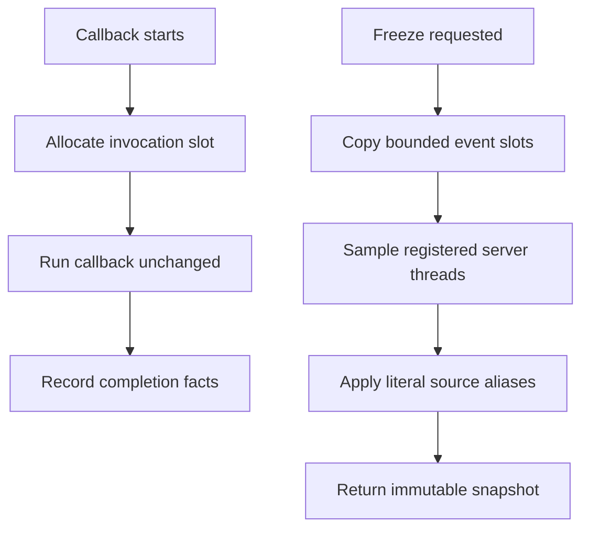

# Daemon probe test tracing

A daemon-probe timeout alone cannot show which callback was reached. This test recorder acts like a checkpoint notebook: callbacks run unchanged while bounded progress markers and selected live server lines are recorded. Test authors receive an immutable snapshot and remain responsible for releasing and joining their workers.

| Component | Plain-English Analogy | Core Responsibility |
| --- | --- | --- |
| `observe` | A checkpoint receipt | Keep each invocation's bounded timing, byte count, outcome and trailing-newline flag |
| Thread registry | A labeled worker list | Sample listener/handler frames and keep join handles; clients are join-only |
| `freeze` | A sealed notebook | Copy bounded events and code-object-matched live lines once |



A test registers a real worker and waits for its pause event. Freezing records that worker's actual source line and callback progress; releasing and joining it later leaves the snapshot unchanged. Failed callbacks preserve the original exception, excess events are counted as omitted, and unavailable introspection produces an explicit state. Event records and snapshots exclude raw arguments, results, exception text, paths, process identifiers and frame objects; thread references remain available for joins.

The private contract lives in [the helper](https://github.com/oimiragieo/tensor-grep/blob/main/tests/unit/daemon_probe_trace_helpers.py): `observe`, `register_thread`, `wait_for`, `join_registered` and `freeze`. This adds test instrumentation with no production caller. Aliases are fixed file/function pairs; unknown and exited frames remain distinguishable. Limits are 64 events, 12 frames per server role and 256 walked frames; byte counts and durations are capped.

Each snapshot is `(events, frames, omissions)`. Event tuples are `(stage, byte_count, duration_us, failed, trailing_newline, complete)`; frame rows contain the role, state and `(file_alias, function_alias, line)` tuples. Byte counts sum direct byte arguments up to 1,000,000; durations cap at 2,000,000 microseconds and omitted-event counts at 65. A trailing-newline flag describes a byte argument or returned text/bytes, not proof of delivery.

To rebuild it, define literal stage/alias allowlists and a separate completion slot per invocation. Add bounded thread registration and live code-object matching, then make freeze copy immutable scalar tuples exactly once. Implement the five controls below using event handshakes, finally-based release/join, ordered outcomes and literal expected paused lines.

| Spec ID | Behavior | CL # | File Link | Unit Test |
| --- | --- | --- | --- | --- |
| TRACE01 | Transparent values/exceptions; private records | D1 | [helper](https://github.com/oimiragieo/tensor-grep/blob/main/tests/unit/daemon_probe_trace_helpers.py) | `test_Observe_SensitiveCallbacks_PreservesIdentityAndPrivacy` |
| TRACE02 | Invocation ownership, cap, immutable freeze | D1 | [controls](https://github.com/oimiragieo/tensor-grep/blob/main/tests/unit/test_daemon_probe_trace_helpers.py) | `test_Observe_CappedOverlappingCallbacks_PreservesEventOwnershipAndSnapshot` |
| TRACE03 | Actual live lines and frame cap | D1 | [controls](https://github.com/oimiragieo/tensor-grep/blob/main/tests/unit/test_daemon_probe_trace_helpers.py) | `test_Freeze_RegisteredDeepWorker_CapturesLiveLinesWithinLimit` |
| TRACE04 | Literal aliases; unknown/absent states | D1 | [controls](https://github.com/oimiragieo/tensor-grep/blob/main/tests/unit/test_daemon_probe_trace_helpers.py) | `test_Freeze_UnknownOrExitedWorkers_ReportsDistinctStates` |
| TRACE05 | Explicit unavailable state | D1 | [controls](https://github.com/oimiragieo/tensor-grep/blob/main/tests/unit/test_daemon_probe_trace_helpers.py) | `test_Freeze_UnavailableIntrospection_ReportsUnavailable` |

From the repository root and its prepared development environment, run:

```sh
uv run --no-sync python -c "import subprocess,sys; subprocess.run([sys.executable,'-m','pytest','-q','tests/unit/test_daemon_probe_trace_helpers.py'],stdin=subprocess.DEVNULL,timeout=180,check=True,creationflags=getattr(subprocess,'CREATE_NO_WINDOW',0))"
```

Expected: five passed tests with zero skips. A failing handshake or callback must fail its control; a passing helper suite establishes recorder behavior only.
