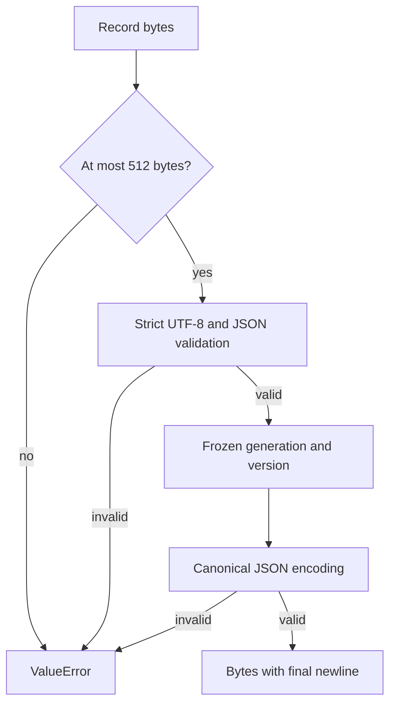

# Managed runtime selection record

**BLUF:** This bounded codec defines one strict identity record for a future matching Python/native runtime generation.

**ELI5:** Think of the record as a small label that names a generation and its release. The codec checks that label before returning a frozen pair, and it writes that pair in one fixed format. A bad label gets a short error that does not repeat its contents.

| Component | Plain-English Analogy | Core Responsibility |
|---|---|---|
| `decode_selection` | Read a label | Check size, encoding, keys, schema, and identity values. |
| `ManagedRuntimeSelection` | Label contents | Hold a frozen generation/version pair. |
| `encode_selection` | Print a label | Validate the pair and return deterministic bytes. |

## Day in the life

Input bytes pass the 512-byte bound before decoding. Strict UTF-8 JSON validation requires exactly three keys, schema version integer `1`, a lowercase 32-hex generation ID, and a numeric `X.Y.Z` release triplet; prerelease, postrelease, and local versions are refused without coercion. Valid input becomes the immutable DTO; encoding validates the same fields and emits compact JSON plus one newline, otherwise a sanitized `ValueError` is raised.

| Planned location | Meaning |
|---|---|
| `.tensor-grep/runtime-selection.json` | The future selection record. |
| `.tensor-grep/runtimes/<generation>/bin/tg.exe` | Native executable for that generation. |
| `.tensor-grep/runtimes/<generation>/.venv/Scripts/python.exe` | Matching Python runtime. |

The byte contract is `{"schema_version":1,"generation":"<32 lowercase hex>","version":"X.Y.Z"}\n`.
The implementation is [src/tensor_grep/cli/managed_runtime_selection.py](https://github.com/oimiragieo/tensor-grep/blob/main/src/tensor_grep/cli/managed_runtime_selection.py); its
regressions are [tests/unit/test_managed_runtime_selection.py](https://github.com/oimiragieo/tensor-grep/blob/main/tests/unit/test_managed_runtime_selection.py).

| Spec ID | Behavior | CL # | File Link | Unit Test |
|---|---|---|---|---|
| UPD-SEL-001 | Strict schema and canonical encoding | UPD-1a | [src/tensor_grep/cli/managed_runtime_selection.py](https://github.com/oimiragieo/tensor-grep/blob/main/src/tensor_grep/cli/managed_runtime_selection.py) | `test_DecodeSelection_InvalidRecord_RaisesSanitizedValueError`; `test_EncodeSelection_ValidRecord_ReturnsCanonicalBytes` |
| UPD-SEL-002 | Frozen pair identifies one generation and release | UPD-1a | [src/tensor_grep/cli/managed_runtime_selection.py](https://github.com/oimiragieo/tensor-grep/blob/main/src/tensor_grep/cli/managed_runtime_selection.py) | `test_DecodeSelection_ValidRecord_ReturnsExactGenerationAndVersion`; `test_ManagedRuntimeSelection_DecodedValue_IsFrozen` |
| UPD-SEL-003 | Bounded input/output and sanitized refusals | UPD-1a | [src/tensor_grep/cli/managed_runtime_selection.py](https://github.com/oimiragieo/tensor-grep/blob/main/src/tensor_grep/cli/managed_runtime_selection.py) | `test_DecodeSelection_MaximumRecordLength_Accepts512Bytes`; `test_EncodeSelection_EncodedRecordOver512Bytes_RefusesBeforeJsonSerialization`; `test_EncodeSelection_MaximumEncodedRecordLength_ReturnsExact512Bytes` |

This is groundwork only: no file reader, trusted-root validation, runtime resolution, activation,
legacy fallback, or updater transaction is implemented. It does not fix the update incident by itself.

Verify with `uv run --no-sync python -m pytest tests/unit/test_managed_runtime_selection.py -q`.
