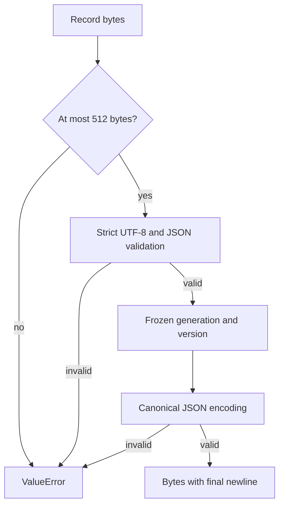

# Managed runtime selection record

**BLUF:** This bounded codec defines the strict identity record used to route Windows managed runs to a matching Python/native runtime generation.

**ELI5:** Think of the record as a small label that names a generation and its release. The codec checks that label before returning a frozen pair, and it writes that pair in one fixed format. A bad label gets a short error that does not repeat its contents.

| Component | Plain-English Analogy | Core Responsibility |
|---|---|---|
| `decode_selection` | Read a label | Check size, encoding, keys, schema, and identity values. |
| `ManagedRuntimeSelection` | Label contents | Hold a frozen generation/version pair. |
| `encode_selection` | Print a label | Validate the pair and return deterministic bytes. |

## Day in the life

Input bytes pass the 512-byte bound before decoding. Strict UTF-8 JSON validation requires exactly three keys, schema version integer `1`, a lowercase 32-hex generation ID, and a numeric `X.Y.Z` release triplet; prerelease, postrelease, and local versions are refused without coercion. Valid input becomes the immutable DTO; encoding validates the same fields and emits compact JSON plus one newline, otherwise a sanitized `ValueError` is raised.

| Planned location | Meaning |
|---|---|
| `.tensor-grep/runtime-selection.json` | The selected generation record. |
| `.tensor-grep/runtimes/<generation>/bin/tg.exe` | Native executable for that generation. |
| `.tensor-grep/runtimes/<generation>/.venv/Scripts/python.exe` | Matching Python runtime. |

The byte contract is `{"schema_version":1,"generation":"<32 lowercase hex>","version":"X.Y.Z"}\n`.
The implementation is [src/tensor_grep/cli/managed_runtime_selection.py](https://github.com/oimiragieo/tensor-grep/blob/main/src/tensor_grep/cli/managed_runtime_selection.py); its
regressions are [tests/unit/test_managed_runtime_selection.py](https://github.com/oimiragieo/tensor-grep/blob/main/tests/unit/test_managed_runtime_selection.py).

Windows primitives in [session_daemon_winsec.py](https://github.com/oimiragieo/tensor-grep/blob/main/src/tensor_grep/cli/session_daemon_winsec.py) retain their existing defaults. `open_no_follow(..., raise_missing=True)` raises only for Windows error 2 (missing leaf); missing parent, access, sharing, reparse, and query failures remain refusals. `read_all(handle, limit=512)` consumes at most 513 bytes including its overflow sentinel; its default remains 8192 bytes. Invalid limits raise before any Windows API call. These primitives do not read `.tensor-grep/runtime-selection.json` or activate generations.

`read_managed_runtime(*, trusted_root)` requires the caller to establish installation authority first. It pins the directory chain and reads only the fixed selector leaf once, with a 512-byte limit. Only a missing selector leaf returns `None`; path, trust, and Win32 failures raise sanitized `OSError`, while strict codec `ValueError`s remain visible. It returns derived native/Python paths for the same generation; those paths are not executable trust proofs, and the reader does not activate either runtime.

`windows_publication.replace_open(descriptor, path)` publishes an owned temporary through its existing DELETE-capable handle using Windows FileRenameInfoEx. It retains old readers while later opens see the new object. The caller must establish destination authority/confinement, flush before publication, and close the writer descriptor immediately afterward. Unsupported OS/filesystem operations raise without a legacy rename or delete fallback; no minimum Windows-version guarantee is claimed. Existing `rename_open(..., replace=...)` keeps its legacy behavior.

Windows integration tests use actual protected directories and handles: replacement preserves the old reader and exposes a new pair afterward. Replacement before final-path validation may refuse safely. A held managed-root handle blocks rename with sharing error 32; rename succeeds after closure.

An experimental source-build-only `tg-recovery-preflight` binary checks two explicitly supplied local Windows x64 artifacts against pinned size and SHA-256 values: the [CPython 3.12.16 standalone archive](https://github.com/astral-sh/python-build-standalone/releases/tag/20261026) and the [uv 0.13.4 Windows wheel](https://pypi.org/project/uv/0.13.4/#files). It performs no recovery, does not inspect the existing installation, and does not establish trust in a later extraction or execution. It is not yet included in release assets. The caller must independently authenticate the binary, launch it from a protected location and working directory, and impose an external timeout. A successful check is not an authorization receipt: inputs must be reopened and verified again before use.

`--verify-python-tree ABSOLUTE_EXTRACTION_PARENT` separately compares enumerated file contents with the pinned Python archive's 3,388-file manifest. The argument names the parent of the extracted `python` directory. The check retains opened file and directory handles during its two enumerations, rejects unexpected files and empty directories, and checks sizes and hashes. Directory enumeration is not atomic: concurrent changes may be missed. It does not validate ownership, ACLs, alternate streams, existing writable mappings, or trust after the handles close, and does not authorize execution or activation.

For a Windows x64 source build, `cargo rustc --manifest-path rust_core/Cargo.toml --locked --release --bin tg-recovery-preflight -- -C target-feature=+crt-static` requests a static CRT. Verification refuses a non-static-CRT build; that check runs after the Windows loader, so it does not make an untrusted binary or directory safe. Inspect the actual release's imports and loaded modules before relying on it.

| Spec ID | Behavior | CL # | File Link | Unit Test |
|---|---|---|---|---|
| UPD-SEL-001 | Strict schema and canonical encoding | UPD-1a | [src/tensor_grep/cli/managed_runtime_selection.py](https://github.com/oimiragieo/tensor-grep/blob/main/src/tensor_grep/cli/managed_runtime_selection.py) | `test_DecodeSelection_InvalidRecord_RaisesSanitizedValueError`; `test_EncodeSelection_ValidRecord_ReturnsCanonicalBytes` |
| UPD-SEL-002 | Frozen pair identifies one generation and release | UPD-1a | [src/tensor_grep/cli/managed_runtime_selection.py](https://github.com/oimiragieo/tensor-grep/blob/main/src/tensor_grep/cli/managed_runtime_selection.py) | `test_DecodeSelection_ValidRecord_ReturnsExactGenerationAndVersion`; `test_ManagedRuntimeSelection_DecodedValue_IsFrozen` |
| UPD-SEL-003 | Bounded input/output and sanitized refusals | UPD-1a | [src/tensor_grep/cli/managed_runtime_selection.py](https://github.com/oimiragieo/tensor-grep/blob/main/src/tensor_grep/cli/managed_runtime_selection.py) | `test_DecodeSelection_MaximumRecordLength_Accepts512Bytes`; `test_EncodeSelection_EncodedRecordOver512Bytes_RefusesBeforeJsonSerialization`; `test_EncodeSelection_MaximumEncodedRecordLength_ReturnsExact512Bytes` |
| UPD-IO-001 | Preserve defaults and distinguish missing leaf from other failures | UPD-1b0 | [Windows primitives](https://github.com/oimiragieo/tensor-grep/blob/main/src/tensor_grep/cli/session_daemon_winsec.py) | `test_OpenNoFollow_OptedMissingFile_RaisesFileNotFoundError`; `test_OpenNoFollow_OptedNonFileNotFoundCreateError_RemainsRefused` |
| UPD-IO-002 | Bound reads before Windows API work | UPD-1b0 | [Windows primitives](https://github.com/oimiragieo/tensor-grep/blob/main/src/tensor_grep/cli/session_daemon_winsec.py) | `test_ReadAll_InvalidLimit_RefusesBeforeWinApi`; `test_ReadAll_Limit512_AcceptsExactBoundaryAndBoundsReads` |
| UPD-IO-003 | Read one trusted selector and return a matched path pair without activation | UPD-1b1 | [src/tensor_grep/cli/managed_runtime_reader.py](https://github.com/oimiragieo/tensor-grep/blob/main/src/tensor_grep/cli/managed_runtime_reader.py) | `test_ReadManagedRuntime_ValidProtectedChain_ReturnsLiteralPairAndClosesReverse`; `test_ReadManagedRuntime_MissingSelectorUnderValidRoot_ReturnsNoneAndClosesChain` |
| UPD-IO-004 | Publish through the owned handle while retaining an old reader | UPD-1b2 | [Windows publication](https://github.com/oimiragieo/tensor-grep/blob/main/src/tensor_grep/io/windows_publication.py) | `test_ReplaceOpen_ExistingTargetWithHeldReader_PublishesNewPairAtomically`; `test_ReplaceOpen_UnsupportedRenameClass_PreservesTargetAndSource` |
| UPD-IO-005 | Validate protected reads and controlled Windows replacements | UPD-1b3 | [Windows controls](https://github.com/oimiragieo/tensor-grep/blob/main/tests/unit/test_managed_runtime_reader_windows.py) | `test_ReadManagedRuntime_SelectorReplaceAfterReadGate_ReturnsOldThenNewPair`; `test_ReadManagedRuntime_HeldRoot_BlocksRenameUntilClosed` |

The [native decoder](https://github.com/oimiragieo/tensor-grep/blob/main/rust_core/src/managed_runtime_selection.rs) enforces the same schema and bounds; its 34 inline tests include array refusal and canonical-size boundaries.

Windows activation repairs the stable dispatcher before publishing a new selector. If repair fails, the prior selector bytes remain selected; if there is no selector yet, the stable launcher keeps its legacy startup path. A candidate older than the selected version is refused before dispatcher repair, and the version guard is repeated before selector replacement under the same lock. Equal-version generations remain eligible for selection. The stable dispatcher candidate is smoke-tested before installation and its installed bytes are checked against the release checksum. Its post-install `--version` probe is skipped because the existing selector would route that probe to the old generation. The caller still must establish installation authority before requesting a read.

Guarded Windows native downloads, including ordinary launcher installs, require a current-user SID and create their temporary asset with a private DACL. Managed downloads additionally pin the asset identity and directory chain during checksum validation, the version probe, and the bounded read used for publication. The bytes read are checked again against the release checksum; an unavailable or untrusted pin stops installation. This protects the managed downloaded source during those steps, not every destination publication or rollback race.

For a fresh generation, the native executable is published through its verified temporary handle without replacing an existing destination. A collision fails staging and leaves the existing object and selector in place. Staging checks the published object's identity and checksum again and retains a read pin through activation or the deferred worker's readiness handshake. A later failure can leave an unselected candidate. Stable dispatcher replacement and metadata publication are separate operations.

The synchronous staging and deferred activation paths share this ordering. Staging raises on dispatcher repair failure; deferred activation returns failure and records the exception type in its activation log. See `test_ManagedStage_WhenStableDispatcherRepairFails_PreservesPreviousSelector` and `test_ActivationWorker_WhenStableDispatcherRepairFails_PreservesPreviousSelector`.

Verify with `uv run --no-sync python -m pytest tests/unit/test_managed_runtime_selection.py tests/unit/test_session_daemon_winsec_read.py tests/unit/test_managed_runtime_reader.py -q`.
