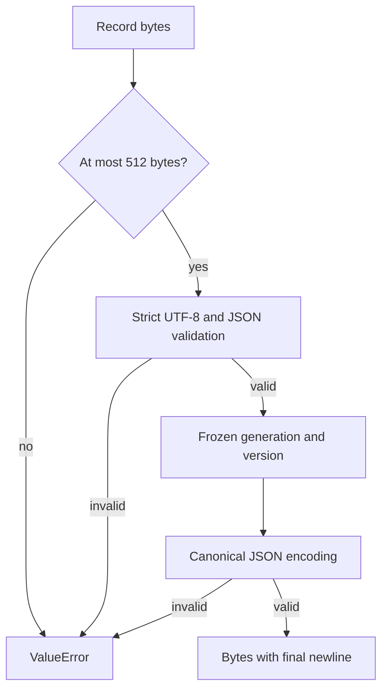

# Managed runtime selection record

**BLUF:** This bounded codec defines one strict identity record for a future matching Python/native runtime generation.

**ELI5:** Think of the record as a small label that names a generation and its release. The codec checks that label before returning a frozen pair, and it writes that pair in one fixed format. A bad label gets a short error that does not repeat its contents.

| Component | Plain-English Analogy | Core Responsibility |
|---|---|---|
| `decode_selection` | Read a label | Check size, encoding, keys, schema, and identity values. |
| `ManagedRuntimeSelection` | Label contents | Hold a frozen generation/version pair. |
| `encode_selection` | Print a label | Validate the pair and return deterministic bytes. |

## Day in the life

Input bytes pass the 512-byte bound before decoding. Strict UTF-8 JSON validation requires exactly three keys, schema version integer `1`, a lowercase 32-hex generation ID, and a numeric `X.Y.Z` release triplet; prerelease, postrelease, and local versions are refused without coercion. Valid input becomes the immutable DTO; encoding validates the same fields and emits compact JSON plus one newline, otherwise a sanitized `ValueError` is raised.

| Planned location | Meaning |
|---|---|
| `.tensor-grep/runtime-selection.json` | The future selection record. |
| `.tensor-grep/runtimes/<generation>/bin/tg.exe` | Native executable for that generation. |
| `.tensor-grep/runtimes/<generation>/.venv/Scripts/python.exe` | Matching Python runtime. |

The byte contract is `{"schema_version":1,"generation":"<32 lowercase hex>","version":"X.Y.Z"}\n`.
The implementation is [src/tensor_grep/cli/managed_runtime_selection.py](https://github.com/oimiragieo/tensor-grep/blob/main/src/tensor_grep/cli/managed_runtime_selection.py); its
regressions are [tests/unit/test_managed_runtime_selection.py](https://github.com/oimiragieo/tensor-grep/blob/main/tests/unit/test_managed_runtime_selection.py).

Windows primitives in [session_daemon_winsec.py](https://github.com/oimiragieo/tensor-grep/blob/main/src/tensor_grep/cli/session_daemon_winsec.py) retain their existing defaults. `open_no_follow(..., raise_missing=True)` raises only for Windows error 2 (missing leaf); missing parent, access, sharing, reparse, and query failures remain refusals. `read_all(handle, limit=512)` consumes at most 513 bytes including its overflow sentinel; its default remains 8192 bytes. Invalid limits raise before any Windows API call. These primitives do not read `.tensor-grep/runtime-selection.json` or activate generations.

`read_managed_runtime(*, trusted_root)` requires the caller to establish installation authority first. It pins the directory chain and reads only the fixed selector leaf once, with a 512-byte limit. Only a missing selector leaf returns `None`; path, trust, and Win32 failures raise sanitized `OSError`, while strict codec `ValueError`s remain visible. It returns derived native/Python paths for the same generation; those paths are not executable trust proofs, and the reader does not activate either runtime.

`windows_publication.replace_open(descriptor, path)` publishes an owned temporary through its existing DELETE-capable handle using Windows FileRenameInfoEx. It retains old readers while later opens see the new object. The caller must establish destination authority/confinement, flush before publication, and close the writer descriptor immediately afterward. Unsupported OS/filesystem operations raise without a legacy rename or delete fallback; no minimum Windows-version guarantee is claimed. Existing `rename_open(..., replace=...)` keeps its legacy behavior.

| Spec ID | Behavior | CL # | File Link | Unit Test |
|---|---|---|---|---|
| UPD-SEL-001 | Strict schema and canonical encoding | UPD-1a | [src/tensor_grep/cli/managed_runtime_selection.py](https://github.com/oimiragieo/tensor-grep/blob/main/src/tensor_grep/cli/managed_runtime_selection.py) | `test_DecodeSelection_InvalidRecord_RaisesSanitizedValueError`; `test_EncodeSelection_ValidRecord_ReturnsCanonicalBytes` |
| UPD-SEL-002 | Frozen pair identifies one generation and release | UPD-1a | [src/tensor_grep/cli/managed_runtime_selection.py](https://github.com/oimiragieo/tensor-grep/blob/main/src/tensor_grep/cli/managed_runtime_selection.py) | `test_DecodeSelection_ValidRecord_ReturnsExactGenerationAndVersion`; `test_ManagedRuntimeSelection_DecodedValue_IsFrozen` |
| UPD-SEL-003 | Bounded input/output and sanitized refusals | UPD-1a | [src/tensor_grep/cli/managed_runtime_selection.py](https://github.com/oimiragieo/tensor-grep/blob/main/src/tensor_grep/cli/managed_runtime_selection.py) | `test_DecodeSelection_MaximumRecordLength_Accepts512Bytes`; `test_EncodeSelection_EncodedRecordOver512Bytes_RefusesBeforeJsonSerialization`; `test_EncodeSelection_MaximumEncodedRecordLength_ReturnsExact512Bytes` |
| UPD-IO-001 | Preserve defaults and distinguish missing leaf from other failures | UPD-1b0 | [Windows primitives](https://github.com/oimiragieo/tensor-grep/blob/main/src/tensor_grep/cli/session_daemon_winsec.py) | `test_OpenNoFollow_OptedMissingFile_RaisesFileNotFoundError`; `test_OpenNoFollow_OptedNonFileNotFoundCreateError_RemainsRefused` |
| UPD-IO-002 | Bound reads before Windows API work | UPD-1b0 | [Windows primitives](https://github.com/oimiragieo/tensor-grep/blob/main/src/tensor_grep/cli/session_daemon_winsec.py) | `test_ReadAll_InvalidLimit_RefusesBeforeWinApi`; `test_ReadAll_Limit512_AcceptsExactBoundaryAndBoundsReads` |
| UPD-IO-003 | Read one trusted selector and return a matched path pair without activation | UPD-1b1 | [src/tensor_grep/cli/managed_runtime_reader.py](https://github.com/oimiragieo/tensor-grep/blob/main/src/tensor_grep/cli/managed_runtime_reader.py) | `test_ReadManagedRuntime_ValidProtectedChain_ReturnsLiteralPairAndClosesReverse`; `test_ReadManagedRuntime_MissingSelectorUnderValidRoot_ReturnsNoneAndClosesChain` |
| UPD-IO-004 | Publish through the owned handle while retaining an old reader | UPD-1b2 | [Windows publication](https://github.com/oimiragieo/tensor-grep/blob/main/src/tensor_grep/io/windows_publication.py) | `test_ReplaceOpen_ExistingTargetWithHeldReader_PublishesNewPairAtomically`; `test_ReplaceOpen_UnsupportedRenameClass_PreservesTargetAndSource` |

This is groundwork only: runtime activation, legacy fallback, and updater transaction remain
unimplemented. The caller still must establish installation authority before requesting a read.

Verify with `uv run --no-sync python -m pytest tests/unit/test_managed_runtime_selection.py tests/unit/test_session_daemon_winsec_read.py tests/unit/test_managed_runtime_reader.py -q`.
