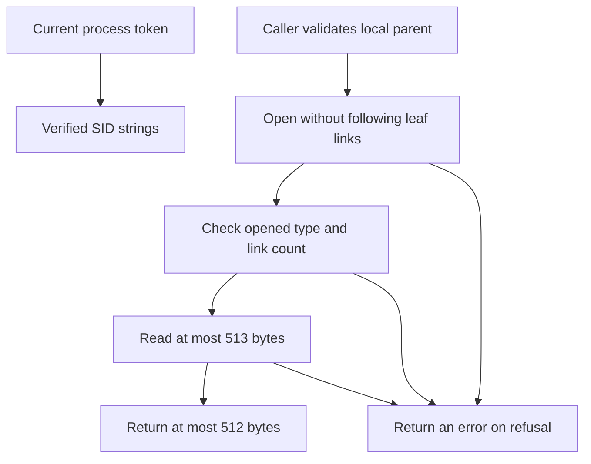

# Native Windows managed-file handles

**BLUF:** These inactive native primitives prevent a selector read from silently following a junction, accepting a hard-linked file, or treating a sharing failure as absence.

**ELI5:** An opened handle is a numbered ticket to one filesystem object. The primitive checks and reads through that ticket while Windows prevents conflicting writes. This groundwork changes no installed runtime or update behavior.

## System map

| Component | Plain-English Analogy | Core Responsibility |
|---|---|---|
| Directory handle | Doorstop | Hold a real directory against rename. |
| Selector handle | Numbered ticket | Bind metadata, final path and bytes to one object. |
| Caller | Security desk | Establish local path, ancestry, ACL and executable authority separately. |

## Day in the life

The future resolver first validates a local ordinary-filesystem path and pins its parent. It calls open_selector on the fixed selector filename. Only initial Windows error 2 returns None; missing parent (3), sharing violation (32), and other errors remain errors. No telemetry is emitted by this inactive file primitive.

The selector permits read/delete sharing, denies write sharing, refuses reparse/type mismatches and requires exactly one hard link. The directory primitive permits read/write sharing and denies delete sharing. Dropping their File owners releases the handles. A failed open or check closes acquired handles through Rust ownership.

final_path queries that same handle into a fixed 32768-unit UTF-16 buffer, refusing oversized/API results and retaining Windows path spelling without lossy conversion. read_record reads at most 513 bytes from the current cursor and refuses overflow; the caller performs one record read.

## Access policy groundwork

[Pure native policies](https://github.com/oimiragieo/tensor-grep/blob/main/rust_core/src/managed_runtime_acl_policy.rs) evaluate caller-verified owner/SID strings and effective known allow grants. Ancestors reject foreign replacement rights and broad write rights; the managed root rejects foreign write rights. The selector permits grants only to the current user, SYSTEM and Administrators. Root/selector ownership may match the verified token default owner; ancestor ownership also permits TrustedInstaller.

A NULL, unavailable or unparsed ACL is None and always refused. An empty, successfully parsed ACL differs from NULL. Actual file ACL acquisition remains unimplemented; unknown ACEs must be rejected by that future parser.

## Current process identity

[The token helper](https://github.com/oimiragieo/tensor-grep/blob/main/rust_core/src/managed_runtime_windows_token.rs) queries the current process, not an impersonated thread, for its user and default owner. It owns one TOKEN_QUERY handle through Rust RAII, bounds aligned queries to 4096 bytes, and checks returned SID spans before SID APIs. Identity fields are private with read-only getters; Debug redacts values. Errors propagate. This does not query file ACLs or select a runtime.

## Contract and rebuilding

The module is Windows-only. It does not validate arbitrary device, pipe, alternate-stream or UNC paths; callers must exclude these before opening. It does not establish ACL, ancestry or executable trust. There are no wire changes, activation flags or installed-state mutations; rollback is a source revert.

Implement using Rust File ownership and OpenOptionsExt, plus the already locked windows-sys 0.61.2 bindings for GetFileInformationByHandle and GetFinalPathNameByHandleW. Register the Windows-only module in lib.rs and the target-specific Foundation/FileSystem features in Cargo.toml. Keep public signatures in [the module](https://github.com/oimiragieo/tensor-grep/blob/main/rust_core/src/managed_runtime_windows_file.rs).

On Windows, run cargo test --manifest-path rust_core/Cargo.toml --no-default-features --lib managed_runtime_windows_file::tests -- --test-threads=1. Require all 14 cases, including actual junction creation and refusal; no optional pass substitutes for that fixture. Full application CI remains required before merge.

| Spec ID | Behavior | CL # | File Link | Unit Test |
|---|---|---|---|---|
| UPD-IO-006 | Handle-bound reads and precise absence | UPD-1c2 | [Native handles](https://github.com/oimiragieo/tensor-grep/blob/main/rust_core/src/managed_runtime_windows_file.rs) | open_selector_missing_parent_returns_error; open_selector_exclusive_existing_handle_returns_sharing_error_not_missing |
| UPD-IO-007 | Real reparse, link and sharing refusals | UPD-1c2 | [Native handles](https://github.com/oimiragieo/tensor-grep/blob/main/rust_core/src/managed_runtime_windows_file.rs) | open_directory_refuses_real_junction; open_selector_hard_link_refuses_multiple_links; open_directory_handle_blocks_rename_until_drop |
| UPD-IO-008 | Preserve the three distinct Windows trust policies | UPD-1c3 | [Native policies](https://github.com/oimiragieo/tensor-grep/blob/main/rust_core/src/managed_runtime_acl_policy.rs) | ancestor_foreign_delete_without_delete_child_is_allowed; parent_foreign_write_grant_is_refused; selector_foreign_read_grant_is_refused |
| UPD-IO-009 | Bound current-process identity reads and redact diagnostics | UPD-1c4 | [Token helper](https://github.com/oimiragieo/tensor-grep/blob/main/rust_core/src/managed_runtime_windows_token.rs) | current_token_sids_rejects_fill_reported_one_byte_short_before_sid_calls; current_token_sids_debug_output_redacts_both_sid_values |

On Windows, also run cargo test --manifest-path rust_core/Cargo.toml --no-default-features --lib managed_runtime_windows_token::tests -- --test-threads=1; require eleven passes. OS-close failure and elevation portability remain unforced.

SID conversion and SDK-owned allocation cleanup share [a private helper](https://github.com/oimiragieo/tensor-grep/blob/main/rust_core/src/managed_runtime_windows_sid.rs); token bounds and diagnostics remain unchanged.
