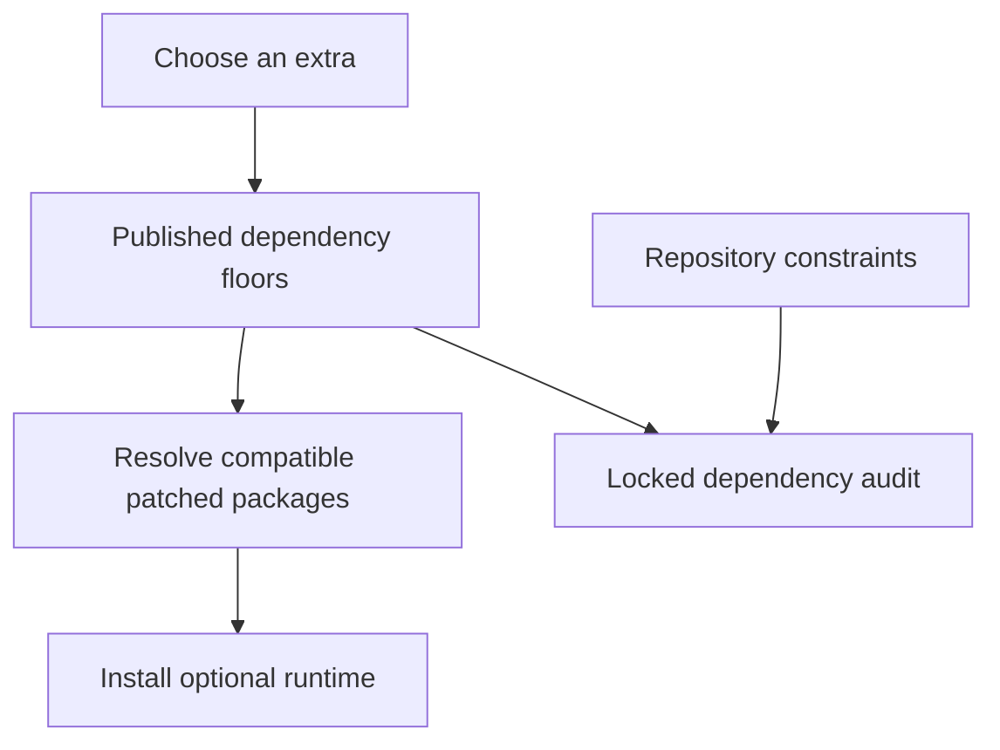

# Optional runtime dependency security

Optional GPU, model, and benchmark installations require patched filelock and setuptools
releases. An older lock could pass ordinary search tests while still failing the dependency
audit. Think of each optional extra as a separate supply crate: its safety label must travel
with the crate, rather than staying in the warehouse ledger. Published extra requirements
and the repository lock now carry the same minimum safe versions.

| Component | Plain-English Analogy | Core Responsibility |
| --- | --- | --- |
| Extra requirements | Shipping label | Protect customer dependency resolution |
| uv constraints and lock | Warehouse ledger | Keep development and CI resolution reproducible |
| Dependency audit | Inspection station | Refuse known vulnerable locked packages |

## Walkthrough and contracts

An operator choosing `gpu`, `gpu-win`, or `bench` receives filelock >= 4.2.1 and,
on Python >= 3.12, setuptools >= 84.1.0 through the Torch dependency path.
The `nlp` and `semantic` extras require filelock >= 4.2.1 through their model-library
dependency paths. `rerank` inherits `semantic`. A core installation gains neither package.

The resolver rejects an environment whose other constraints cannot satisfy these floors;
it must not silently retain an affected release. Existing installations must upgrade the
package with their chosen extras to obtain the updated requirements. Search output, MCP
contracts, telemetry, and daemon state do not change.

The floors address the dependency audit's filelock findings CVE-2026-112940,
CVE-2026-112913, and CVE-2026-112907, and setuptools finding GHSA-xmj3-9gf7-h52w.
The upstream [filelock advisory](https://github.com/advisories/GHSA-v4x8-3wr5-3wq8)
and [setuptools advisory](https://github.com/advisories/GHSA-xmj3-9gf7-h52w)
document patched releases and attack prerequisites. These findings do not establish that
Tensor-grep itself exercises the affected APIs.

## Reproduce and verify

1. Read the affected extras and constraints in [pyproject.toml](/pyproject.toml).
2. Run `uv lock --no-build --upgrade-package filelock --upgrade-package setuptools`.
   Review the lock diff: only these package records and project requirement metadata should change.
3. Run `uv run --no-sync pytest tests/unit/test_optional_runtime_security_floors.py
   tests/unit/test_security_dependency_floors.py tests/unit/test_audit_workflow_contract.py`.
   Expect all cases to pass, including the control that core installs remain unchanged.
4. Require the unchanged dependency audit in normal PR CI before merging. Local metadata
   tests do not substitute for the advisory scan or optional-runtime compatibility tests.

Rollback is a normal commit revert of metadata, lock, and tests together. It restores
known vulnerable resolutions, so use a forward dependency correction if compatibility fails.

| Spec ID | Behavior | CL # | File Link | Unit Test |
| --- | --- | --- | --- | --- |
| SEC-OPTIONAL-01 | Publish patched extra floors | SEC-1 | [metadata](/pyproject.toml) | `test_Metadata_AffectedExtra_PublishesPatchedFloor` |
| SEC-OPTIONAL-02 | Lock patched releases | SEC-1 | [lock](/uv.lock) | `test_Lock_OptionalRuntimeAdvisory_ExcludesAffectedRelease` |
| SEC-OPTIONAL-03 | Keep core install unchanged | SEC-1 | [tests](/tests/unit/test_optional_runtime_security_floors.py) | `test_Metadata_CoreInstall_DoesNotAddOptionalRuntimePackages` |
