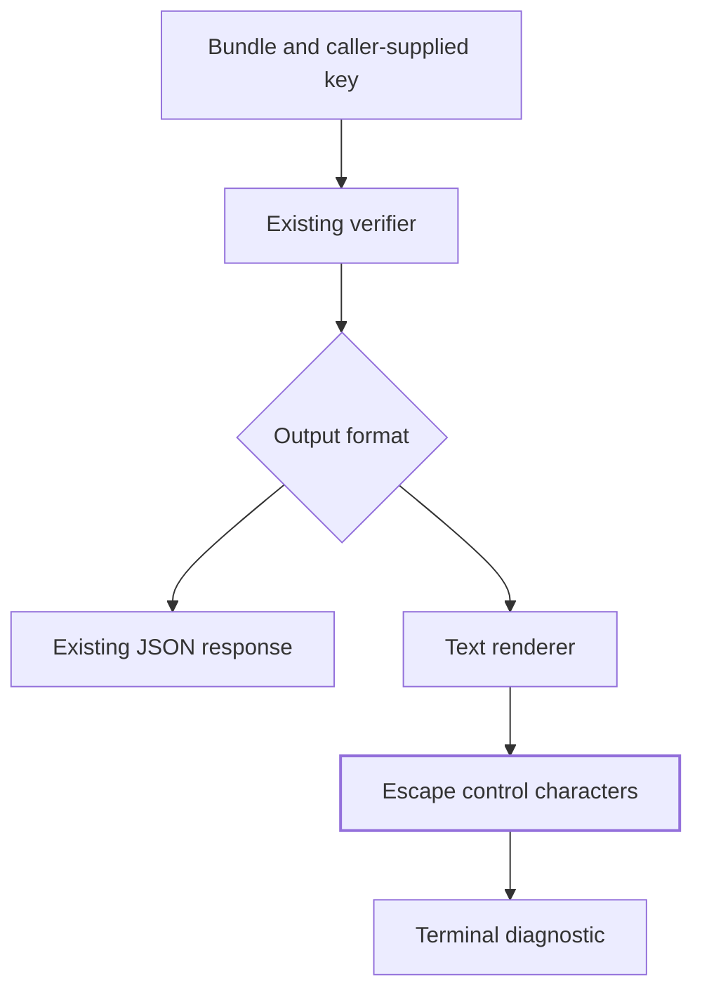

# Review-bundle terminal diagnostics

Review-bundle verification must display untrusted diagnostics without letting them operate a terminal. Think of visible escaping as putting the diagnostic behind glass: every character stays readable, but control characters cannot execute terminal instructions. Users receive the same verification decision and a safe, single-line diagnostic.

## System map

| Component | Plain-English analogy | Core responsibility |
|---|---|---|
| Verifier | Inspector | Check integrity, signatures and policy |
| JSON response | Structured report | Preserve existing keys and decisions |
| Text renderer | Display window | Preserve normal wording and escape controls |

## A day in the life

A developer verifies a bundle using the existing command and supplies the required signing key as described in the [review-bundle guide](/docs/enterprise_review_bundle_ci.md). The verifier checks the artifacts and produces its normal result. This change adds no storage operation, signing rule, telemetry event or key lookup.

For text output, the renderer escapes controls before each complete line reaches Typer. An ESC character appears as literal `\u001b` text, so it cannot start a color change or terminal command. Ordinary Unicode filenames, quotes and backslashes remain readable; Typer supplies the final newline.

A receipt with an unsupported signing algorithm still fails signature verification. Its digest and integrity findings retain their meaning; escaping cannot make it valid. JSON retains its existing structured refusal and exit status. Missing or wrong keys remain errors; a key path in a manifest does not become trusted.

## Rebuild the behavior

Start with [the renderer](/src/tensor_grep/cli/review_bundle_render.py) and its unchanged public signature: `render_review_bundle_verification(payload: dict[str, Any]) -> None`. Add one private line-output helper and route every renderer output through it.

Inspect each Unicode code point. Values below 32, values from 127 through 159, and surrogates from U+D800 through U+DFFF become `json.dumps(character, ensure_ascii=True)[1:-1]`. Preserve other characters exactly, join the result, and call the real `typer.echo` once. Keep existing JSON quoting of manifest-signature errors; do not double-escape an already-visible backslash.

This boundary neutralizes complete and partial terminal sequences because their control introducers cannot reach the terminal. It adds no parser, bypass flag, environment override, schema version or fallback.

Run the focused renderer tests with the existing review-bundle, evidence-receipt and audit-manifest-signing suites in the canonical environment, using an external process timeout. Require literal text assertions, a printable Unicode/backslash control, a real valid bundle, and a real rejected hostile receipt in text and JSON. Then run the repository's required formatting, lint, typing, size and hygiene checks.

Verify source-bootstrap behavior before merge and the matching published artifact after release. Direct renderer tests do not prove CLI wiring or installed-wheel behavior.

## Contract and traceability

The [public contracts](/docs/CONTRACTS.md) retain authority over verification. Response keys, signature decisions, method signature and exit codes remain unchanged. Embedded control characters in text become visible escapes.

| Spec ID | Behavior | CL | File | Unit test |
|---|---|---|---|---|
| DF10-R1-TEXT | Neutralize text controls | DF10-R1 | [renderer](/src/tensor_grep/cli/review_bundle_render.py) | test_RenderReviewBundle_ControlCodePoint_EmitsSingleSafeLine |
| DF10-R1-COMPAT | Preserve printable text and quoting | DF10-R1 | [tests](/tests/unit/test_review_bundle_terminal_safety.py) | test_RenderReviewBundle_PrintablePayload_PreservesCompleteText |
| DF10-R1-VERIFY | Preserve real signature refusal | DF10-R1 | [tests](/tests/unit/test_review_bundle_terminal_safety.py) | test_VerifyReviewBundle_HostileAlgorithmJson_PreservesStructuredRefusal |
| DF10-R1-DOCS | Explain operation and rollback | DF10-R1 | [this page](/docs/review-bundle-terminal-safety.md) | Documentation build and link checks |

Rollback reverts this focused change and restores the original display vulnerability. Prefer a corrective follow-up that preserves verification decisions. No data migration or index rebuild is needed.
