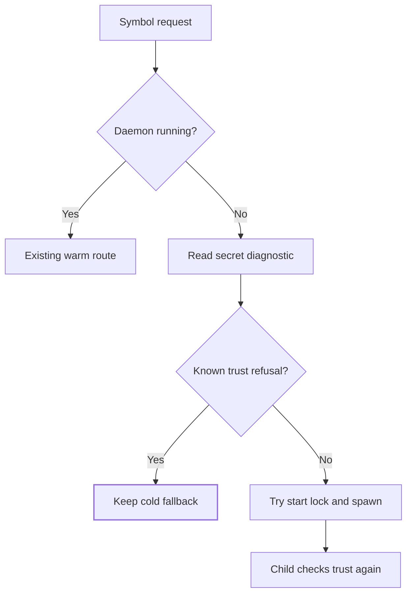

# Session Daemon Protocol

The warm-session daemon is the only network-listening surface `tg` has. This page
specifies its wire protocol and its authentication model.

Implementation symbols refer to `src/tensor_grep/cli/session_daemon.py`.

> **Cite the symbol, not the line.** Constants are named here rather than pinned to line
> numbers, which drift. Locate them with
> `tg search -n '_DAEMON_HOST|_MAX_DAEMON_REQUEST_BYTES' src/tensor_grep/cli/session_daemon.py`.

---

## 1. Transport and binding

| Property | Value | Constant |
|---|---|---|
| Host | `127.0.0.1` — loopback only, never `0.0.0.0` | `_DAEMON_HOST` |
| Port | ephemeral, recorded in the session metadata file | — |
| Framing | one JSON object per line, UTF-8, `\n`-terminated | — |
| Connect timeout | 0.5 s | `_DAEMON_CONNECT_TIMEOUT_SECONDS` |
| Per-request socket read timeout | 30 s | `_DAEMON_HANDLER_TIMEOUT_SECONDS` |
| Startup wait | 5 s | `_DAEMON_START_TIMEOUT_SECONDS` |

The daemon is a local IPC mechanism, not a service. Binding to loopback is a hard
requirement: it is the outer boundary that keeps the token from being the *only* thing
between an attacker and the index.

---

## 2. Authentication

### Token generation

`run_session_daemon_server` generates `secrets.token_urlsafe(32)` per daemon instance.
Tokens are never derived from the path, PID, or anything guessable, and never reused
across daemons.

### Token storage

The token is written into the session metadata file, created with:

```python
os.open(tmp_path, os.O_WRONLY | os.O_CREAT | os.O_EXCL, _DAEMON_METADATA_MODE)  # 0o600
```

Three properties matter, and all three are deliberate:

- **`O_EXCL`** — creation fails if the path already exists, so a pre-planted file cannot
  be written through.
- **Mode passed to `os.open`**, not applied afterwards with `chmod`. The kernel applies
  `0o600` *atomically at creation*, so there is no window in which the file exists and is
  world-readable. A write-then-chmod sequence has exactly that window.
- **Windows ACL restriction** is attempted before the token bytes are written.
  This is best-effort protection; operators must still verify the metadata file
  is accessible only to the intended local user.

### The authorization gate

Every request carries the token in a top-level `"token"` field
(`_DAEMON_TOKEN_FIELD`). `_ThreadedSessionDaemon.is_authorized` decides:

```python
if not self.token:
    return False  # fail closed, see below
provided = request.get(_DAEMON_TOKEN_FIELD)
if not isinstance(provided, str) or not provided:
    return False
return hmac.compare_digest(provided, self.token)  # constant time
```

`hmac.compare_digest` is required to avoid data-dependent comparison timing.
A plain equality check does not provide the same constant-time comparison contract.

### Fail-closed on a tokenless daemon

**A daemon with no token refuses everything.** This reversed an earlier behaviour where
tokenless meant "authorize everything" as a legacy/in-test convenience.

The reasoning is worth preserving, because the earlier behaviour is the tempting one:
production *always* generates a token, so a tokenless daemon is a **misconfiguration**.
A misconfiguration must refuse everything, never accept everything — the failure mode of
a broken gate must be denial.

Tokenless *construction* remains legal (some lifecycle tests need it); only tokenless
*authorization* is forbidden. The invariant lives in `is_authorized` alone — the
constructor deliberately does not also raise, so there is exactly one place to audit.

---

## 3. Ordering: authenticate before anything else

`_SessionDaemonHandler.handle` performs, strictly in this order:

1. **Bounded read** of one request line (§4) — before parsing.
2. **`json.loads`**.
3. **`is_authorized`** — *before dispatching any command or resolving any path*.
4. Only then: activity note, in-flight accounting, session resolution, dispatch.

Steps 3 and 4 must not be reordered. Resolving a path before authenticating would let an
unauthenticated client probe the filesystem through error messages. In-flight accounting
is also deliberately *after* auth, so unauthenticated clients cannot hold the daemon open
against its own idle-shutdown lifecycle.

An unauthorized request receives a fixed, non-informative envelope and the connection
closes:

```json
{"version": …, "session_id": "", "error": {"code": "unauthorized", "message": "invalid or missing daemon token"}}
```

The message is identical for a missing token, a malformed token, and a wrong token.
Distinguishing them would be an oracle.

---

## 4. Pre-authentication DoS bound

`_read_bounded_request_line` reads at most `_MAX_DAEMON_REQUEST_BYTES` (**1 MiB**).

A bare `rfile.readline()` with no size argument buffers an entire line into memory
*before* the caller can authenticate, so one hostile local client sending an endless line
with no newline exhausts memory without ever holding a credential. The bound is therefore
applied **pre-auth**, together with the 30 s socket read timeout — an attacker must not
be able to consume unbounded memory *or* unbounded time before proving who they are.

---

## 5. Startup diagnostics

`tg session daemon start --json` exits 1 on failure and emits `ok: false` with
`error.reason_code` and `error.detail`. The detail is a human-readable message;
callers should use the reason code for decisions.

| Reason code | Meaning |
|---|---|
| `secret_untrusted_present` | An existing per-user secret is not trusted. |
| `secret_extra_links` | The secret has unexpected hard links. |
| `secret_dir_unavailable` | The per-user state directory is unavailable. |
| `secret_dir_untrusted_owner_or_acl` | The state directory grants another account write access. |
| `secret_ancestor_untrusted` | An ancestor of the state directory is not trusted. |
| `secret_io_error` | An I/O error prevented the secret check. |
| `secret_unavailable` | The secret could not be loaded or created and no specific trust failure was diagnosed, for example because another tg process held its lock. |
| `daemon_start_failed` | Startup failed without a more specific reason. |

`tg doctor` reports `session_daemon.start_error` as `null` when the read-only secret
check finds no problem, or as an object with `reason_code` and `detail` when it does.
This check does not diagnose secret-lock contention.

### Automatic start preflight

An untrusted per-user secret can make repeated implicit daemon starts fail. A read-only preflight acts like a doorkeeper that declines an already-known unsafe entrance. Search continues through its existing cold path, while a later repaired permission allows another start attempt.



| Component | Plain-English analogy | Core responsibility |
|---|---|---|
| Preflight | Doorkeeper | Avoid a known-refused spawn |
| Start lock | One-person entrance | Retain existing spawn coordination |
| Child trust check | Final inspector | Enforce security even after a race |

Rebuild this behavior in [the source](/src/tensor_grep/cli/session_daemon.py): keep the existing running-daemon probe first, call diagnose_user_secret next, and return False before taking the start lock only for secret_dir_untrusted_owner_or_acl, secret_ancestor_untrusted, secret_untrusted_present or secret_extra_links. Keep the public signature maybe_autostart_session_daemon_nonblocking(path: str = ".") -> bool.

For example, a defs request with no warm daemon and an unsafe secret directory returns to cold search without requesting a child. After an operator repairs permissions, the next request checks again and may attempt initialization. There is no persistent disabled state. A missing directory, no diagnostic, or secret_io_error still reaches existing initialization; the child remains authoritative for races, missing-directory ancestry and other failures.

The preflight adds no telemetry event, credential write, ACL repair, wire key or schema change. Explicit daemon start retains its actionable reason codes. The existing TG_SESSION_DAEMON_AUTOSTART opt-out remains available.

| Spec ID | Behavior | CL | File | Unit test |
|---|---|---|---|---|
| DF05-SUPPRESS | Decline four known trust refusals | DF05-01 | [source](/src/tensor_grep/cli/session_daemon.py) | test_autostart_KnownSecretTrustRefusal_ReturnsFalse |
| DF05-PASS | Preserve initialization and transient I/O | DF05-01 | [tests](/tests/unit/test_session_daemon_autostart_trust.py) | test_autostart_TrustedOrFirstRunSecret_AllowsInitialization |
| DF05-RECOVER | Recheck repaired trust on the same root | DF05-01 | [tests](/tests/unit/test_session_daemon_autostart_trust.py) | test_autostart_TrustRepairedOnSameRoot_AllowsNextAttempt |
| DF05-LOCK | Release the existing start lock | DF05-01 | [tests](/tests/unit/test_session_daemon_autostart_trust.py) | test_autostart_PreviousAttemptCompleted_ReleasesStartLock |

Run the focused trust and autostart tests under an external timeout, then the required static/security checks and supported-platform CI. Do not infer a latency improvement or host-wide ACL correctness from deterministic stubs. Rollback reverts this preflight and restores the previous attempted starts; child trust enforcement must remain unchanged.

---

## 6. Rebuilding this component: verification checklist

A rebuild is correct only if all of these hold. Each is a property to test, not to read.

- [ ] The listener binds `127.0.0.1` and **cannot** be configured to `0.0.0.0`.
- [ ] Each daemon generates a fresh cryptographically-random token.
- [ ] The metadata file is created with `O_CREAT|O_EXCL` and mode `0o600` **passed to
      `os.open`**; verify no window exists where the file is readable by others.
- [ ] A request with **no** token is refused.
- [ ] A request with a **wrong** token is refused.
- [ ] A request with the **correct** token succeeds. *(Without this arm the previous three
      pass trivially against a gate that refuses everything.)*
- [ ] Token comparison is constant-time — assert `hmac.compare_digest` is the comparator;
      a timing test is too noisy to be the gate.
- [ ] A daemon constructed **without** a token refuses every request, including one
      carrying an empty token.
- [ ] A request line exceeding 1 MiB is rejected **without** the process buffering it.
- [ ] No filesystem path is resolved before authorization — assert on the code path taken,
      not on wall-clock behaviour.
- [ ] Unauthorized responses are byte-identical across missing / malformed / wrong tokens.

The sixth item is the one people skip, and it is the one that makes the other refusal
arms meaningful: a gate that denies everything passes every negative test.
