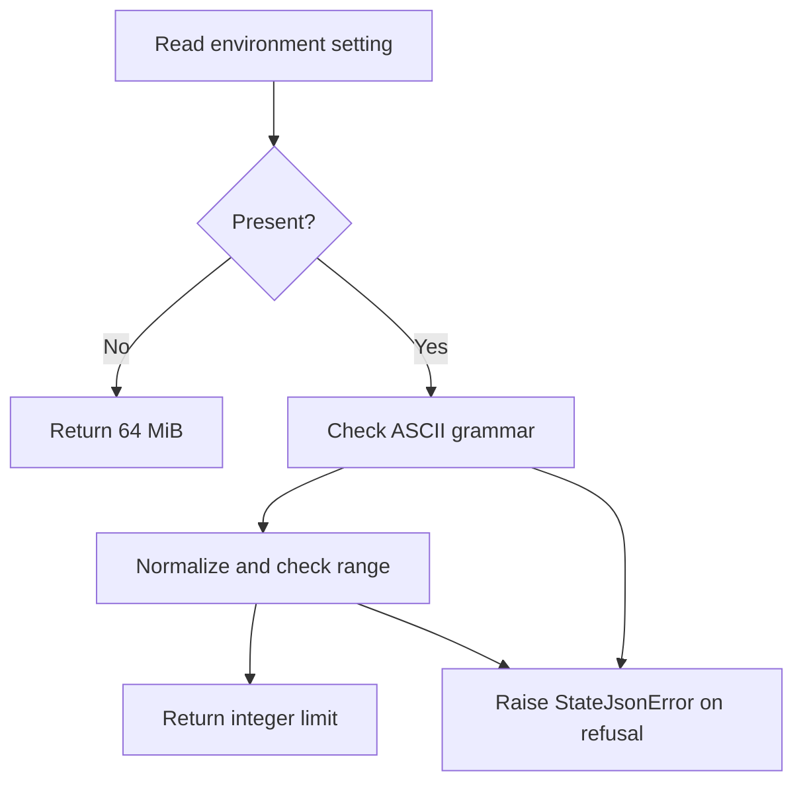

# Configure the Python state JSON helpers

**BLUF:** `configured_state_json_limit()` validates `TG_STATE_JSON_MAX_BYTES` and returns
an integer byte limit. Its default is 64 MiB (67,108,864 bytes). Store consumers have not
been connected to this setting, so setting it does not yet cap session or checkpoint files.

Treat the setting as a capacity label for a future JSON operation. Reading the label does
not read, write, or change a state file.

| Component | Analogy | Responsibility |
| --- | --- | --- |
| Environment variable | Capacity label | Supplies a decimal token |
| Grammar check | Reading the label | Accepts only the documented ASCII syntax |
| Range check | Checking capacity | Requires 1 through `sys.maxsize - 1` |



## Walkthrough

A caller invokes `configured_state_json_limit()` and receives a positive integer or a
`StateJsonError`. An unset variable selects the default. Otherwise the complete token must
contain ASCII digits, optionally preceded by one sign, with single underscores only between
digits. Outer whitespace may be space, tab, newline, carriage return, form feed, or vertical tab.

Accepted examples include `1024`, `+1_024`, `00016`, and ` 16 `. Unicode digits and whitespace,
internal whitespace, repeated separators, decimal points, and exponent notation are rejected.
Malformed tokens report “must be a decimal integer”. Zero, negatives, and values above the
platform maximum report a range error. Diagnostics do not echo the supplied token.

Set the variable in the current PowerShell process:

```powershell
$env:TG_STATE_JSON_MAX_BYTES = '+67_108_864'
```

The parser removes separators and leading zeros before comparing significant decimal digits
with the platform maximum. Integer conversion therefore stays small even under Python's
integer digit ceiling. Scanning a long token still uses time and memory proportional to its
length. The setting describes serialized bytes, not Python object memory or record counts.

The configuration and [reader](state-json-reading.md) APIs are available; encoding is follow-up
work. Existing stores have not adopted these helpers. The independent Rust producer does not read
this Python setting. Callers that later adopt it must capture the result once per operation and
pass that same integer to helpers.

| Spec ID | Behavior | CL | File | Unit test |
| --- | --- | --- | --- | --- |
| NATIVE-CONFIG-GRAMMAR | ASCII grammar, normalization, range | G1-A | [state_json.py](https://github.com/oimiragieo/tensor-grep/blob/main/src/tensor_grep/cli/state_json.py) | `test_Config_AsciiSignedUnderscoredDecimal_ReturnsExpectedLimit`, `test_Config_NonAsciiOrMalformedToken_RaisesDecimalError`, `test_Config_AsciiNumericOutsideRange_RaisesRangeError` |
| NATIVE-CONFIG-GRAMMAR | Digit ceiling and default | G1-A | [tests](https://github.com/oimiragieo/tensor-grep/blob/main/tests/unit/test_state_json_budget.py) | `test_Config_LongLeadingZeroTokenWithDigitCeiling_ReturnsOne`, `test_Config_LongNumericTokenWithDigitCeiling_RaisesRangeError`, `test_Config_UnsetValue_Uses64MiBDefault`, `test_Config_MaximumAccepted_ReturnsValue` |

Return to the default with:

```powershell
Remove-Item Env:TG_STATE_JSON_MAX_BYTES -ErrorAction SilentlyContinue
```
