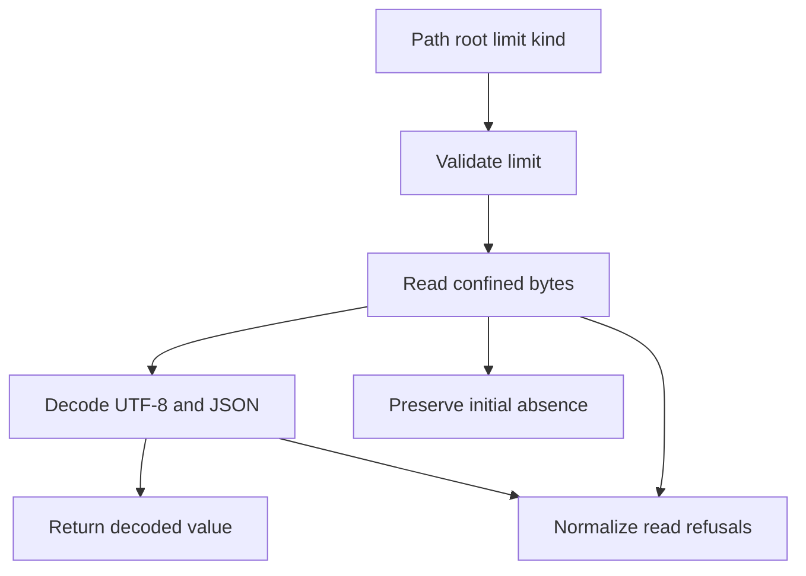

# Read bounded Python state JSON

**BLUF:** `read_state_json(path, *, trusted_root, limit, kind)` reads one confined UTF-8 JSON file within an explicit byte limit. The helper is available for future store integration; existing session and checkpoint consumers have not adopted it.

Imagine `trusted_root` as the outside edge of a filing cabinet.
The byte limit is the maximum size of one paper packet.
The reader checks the cabinet and packet before showing you decoded pages.

| Component | Analogy | Responsibility |
| --- | --- | --- |
| Limit validation | Capacity check | Refuses invalid explicit integer limits before I/O |
| Confined reader | Cabinet boundary | Checks the path and serialized byte limit |
| JSON decoder | Document reader | Decodes UTF-8 and parses JSON |

## Walkthrough

Capture the limit once with `configured_state_json_limit()`, then pass that value, a path, the original trusted root, and a diagnostic kind to `read_state_json`. For example, a session caller passes `kind="session"`; the returned object is parsed JSON, not a validated session record. Callers still validate their own schema and unknown fields.

A missing trusted root, parent, or leaf found before the leaf is observed remains `FileNotFoundError`. This reports path absence; it does not prove that creating a record is safe. Callers must establish their trusted-root and creation policy. Pass `kind` as a fixed, nonsensitive diagnostic label because it is included in sanitized error text. Invalid limits are rejected before filesystem access. Other confined-reader `OSError` and `ValueError` failures, including a file that disappears after observation, become `StateJsonError` with a sanitized read diagnostic. Invalid UTF-8, malformed JSON, and integers beyond Python's conversion ceiling become a sanitized invalid-document `StateJsonError`. A `RecursionError` raised by the standard JSON decoder is normalized the same way; decoder behavior can vary, so the helper does not promise a fixed nesting-depth limit.

The reader preserves Python's standard JSON behavior: `NaN` remains accepted and duplicate keys keep the last value. This adds no on-disk format. The byte limit applies to serialized bytes, not total process RAM. Confined reading can accumulate chunks and join them, and decoded Python objects consume additional memory.

## Contract delta

G1-B adds a reusable confined read API to the G1-A configuration module. Existing stores continue using their current readers until a later integration change. The Rust producer, write behavior, encoding behavior, and persistent state format are unchanged.

## Failure and rollback

Check the exception class and sanitized diagnostic before deciding whether a caller should create, retry, or refuse a record. Do not turn a refusal into an empty object. Because no store is connected to this helper, rollback is to remove the helper, its tests, and this guide while no dependent consumer has shipped; no user-state conversion or cleanup is needed.

| Spec ID | Behavior | Change | Source and regression cases |
| --- | --- | --- | --- |
| G1-READ | Initial absence and post-read disappearance | G1-B | [state_json.py](https://github.com/oimiragieo/tensor-grep/blob/main/src/tensor_grep/cli/state_json.py), [test_state_json_budget.py](https://github.com/oimiragieo/tensor-grep/blob/main/tests/unit/test_state_json_budget.py): `test_Reader_InitialLeafAbsence_RemainsFileNotFound`, `test_Reader_InitialTrustedRootAbsence_RemainsFileNotFound`, `test_Reader_ObservedLeafDisappearance_RaisesStateJsonError` |
| G1-READ | JSON compatibility and failure normalization | G1-B | [confined.py](https://github.com/oimiragieo/tensor-grep/blob/main/src/tensor_grep/io/confined.py), [test_state_json_budget.py](https://github.com/oimiragieo/tensor-grep/blob/main/tests/unit/test_state_json_budget.py): `test_Reader_NaNConstant_PreservesStdlibJsonBehavior`, `test_Reader_DuplicateKey_PreservesLastValue`, `test_Reader_InvalidUtf8OrJson_RaisesStateJsonError`, `test_Reader_DeepJson_RefusesWithStateJsonError` |
| G1-READ | Validate before I/O and enforce confinement | G1-B | [state_json.py](https://github.com/oimiragieo/tensor-grep/blob/main/src/tensor_grep/cli/state_json.py): `test_Config_InvalidMaximum_IsRejectedBeforeRead`, `test_Config_UnicodeToken_IsRejectedBeforeStateRead`, `test_Config_ValidToken_ReachesConfinedRead`, `test_Reader_InvalidLimit_IsRejectedBeforeFilesystemAccess`, `test_Reader_OversizedFile_RaisesStateJsonError`, `test_Reader_OutsideTrustedRoot_RaisesStateJsonError` |

The encoder remains a follow-up. This helper does not activate a limit in the independent Rust producer.
