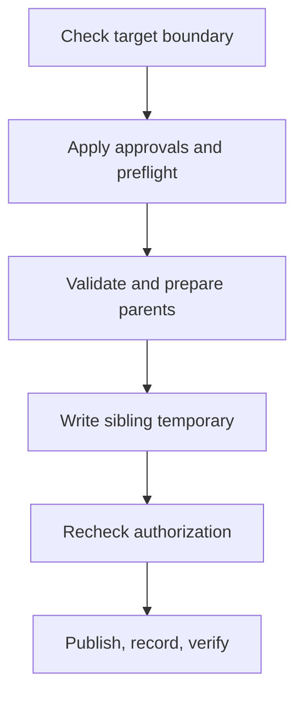

# Confined state-file publication

Confined state writes must preserve the caller's approvals and stay inside the supplied root. Treat the root as a fenced yard and an active approval scope as the list of objects its owner allows the worker to change. These helpers reject parent traversal before filesystem inspection and preserve evidence when publication succeeds but final verification fails.

| Component | Plain-English Analogy | Core Responsibility |
| --- | --- | --- |
| [`io/confined.py`](https://github.com/oimiragieo/tensor-grep/blob/main/src/tensor_grep/io/confined.py) | Fence and gate | Checks lexical boundaries, real parents and publication identity. |
| [`cli/_index_lock.py`](https://github.com/oimiragieo/tensor-grep/blob/main/src/tensor_grep/cli/_index_lock.py) | Approval desk | Checks active approvals, preserves approved absence and records published labels. |

## Walkthrough

Suppose an approved output is `root/cache/state.json`. `atomic_write_bytes_confined(root, path, data)` checks the normalized target is strictly below the root. When a scope is active, an unlisted target is refused and every approved output is checked before parent or temporary-file creation. No active scope means no approval-list requirement.



The writer validates existing parents, prepares permitted missing parents and writes a temporary file beside the destination. `before_publish` rechecks authorization immediately before publication. An output approved as absent uses no-clobber publication: a competing file survives and publication refuses.

`on_published` records the authorized label immediately after publication, before final verification. If verification fails, the refusal can report an output already written. Labels live in memory; they are not a durable audit log. Windows marks the temporary as published before this callback, preventing failure cleanup from discarding a published file.

## Contract changes and limits

G0a adds the approval-aware confined writer without changing the existing anchored writer's signature. G0D adds a shared lexical check before metadata access or directory creation:

- `read_confined`, `publish_confined` and `validate_confined_parent_prefix` require a nonempty path below the supplied root.
- Any `..` component in the relative tail raises `OSError`, including `child/../file` that would return inside the root. Root equality also raises `OSError` for those three APIs.
- An already-outside or incompatible relative/absolute path retains `ValueError`. Ordinary relative root/path pairs remain supported.
- `prepare_directory(root, root)` remains an unchecked no-op; it does not validate the root. Descendant preparation applies the lexical and real-parent checks.

The higher authorization wrapper normalizes paths before invoking the low-level helpers. The shared check does not resolve away links. Existing link, junction and opened-object identity checks still apply. A missing parent suffix is accepted only after the observed parent identities are rechecked.

This is not filesystem compare-and-swap: another process running as the same user can change a directory entry between identity checking and replacement. Some interference is detected after publication, so refusal does not always mean nothing became visible. Authority above the supplied root is outside these helpers' checks.

## Traceability

| Spec ID | Behavior | CL # | File Link | Unit Test |
| --- | --- | --- | --- | --- |
| G0-AUTH | Refuse unlisted outputs before creation | G0A-CODE | [`_index_lock.py`](https://github.com/oimiragieo/tensor-grep/blob/main/src/tensor_grep/cli/_index_lock.py) | [`test_AtomicConfinedWrite_UnlistedTarget_IsRefusedBeforeCreation`](https://github.com/oimiragieo/tensor-grep/blob/main/tests/unit/test_authorized_confined_publication.py) |
| G0-OWN | Record publication before final verification | G0A-CODE | [`confined.py`](https://github.com/oimiragieo/tensor-grep/blob/main/src/tensor_grep/io/confined.py) | [`test_AtomicConfinedWrite_PostPublishVerificationFails_ReportsWrittenLabel`](https://github.com/oimiragieo/tensor-grep/blob/main/tests/unit/test_authorized_confined_publication.py) |
| G0D | Refuse parent tails before metadata; preserve valid paths | G0D-PATH | [`confined.py`](https://github.com/oimiragieo/tensor-grep/blob/main/src/tensor_grep/io/confined.py) | [`test_ConfinedOperation_ParentTail_RefusesBeforeMetadata`](https://github.com/oimiragieo/tensor-grep/blob/main/tests/unit/test_confined_lexical_containment.py) |

## Bounded verification on Windows

From the repository root, with the development `.venv` configured, paste this into PowerShell. It runs focused tests with a 300-second timeout. The context manager owns and removes the temporary test directory on success or exception; the pytest child receives no interactive input or new console window.

```powershell
@'
import subprocess
import sys
import tempfile
from pathlib import Path

repository = Path.cwd()
creation_flags = subprocess.CREATE_NO_WINDOW
with tempfile.TemporaryDirectory(prefix="tg-confined-check-") as temporary:
    result = subprocess.run(
        [
            sys.executable,
            "-m",
            "pytest",
            "-q",
            "tests/unit/test_authorized_confined_publication.py",
            "tests/unit/test_confined_io.py",
            "tests/unit/test_confined_lexical_containment.py",
            "--basetemp",
            str(Path(temporary) / "pytest"),
        ],
        cwd=repository,
        stdin=subprocess.DEVNULL,
        capture_output=True,
        encoding="utf-8",
        errors="replace",
        timeout=300,
        creationflags=creation_flags,
    )
    print(result.stdout, end="")
    print(result.stderr, end="", file=sys.stderr)
    result.check_returncode()
'@ | & .\.venv\Scripts\python.exe -
```
