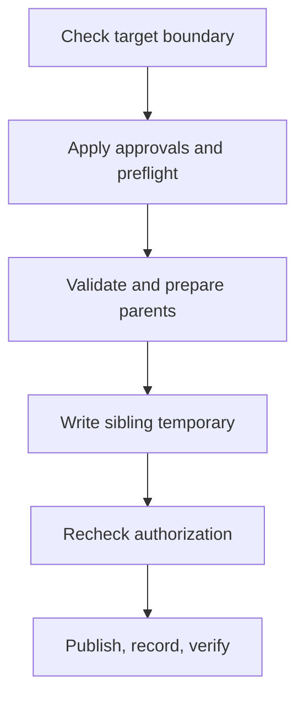

# Confined state-file publication

Confined writes stay below the supplied root and preserve caller approvals. Active scopes list authorized outputs. Helpers reject parent traversal before metadata access and retain evidence if publication succeeds but verification fails.

| Component | Plain-English Analogy | Core Responsibility |
| --- | --- | --- |
| [`io/confined.py`](https://github.com/oimiragieo/tensor-grep/blob/main/src/tensor_grep/io/confined.py) | Fence and gate | Checks lexical boundaries, real parents and publication identity. |
| [`cli/_index_lock.py`](https://github.com/oimiragieo/tensor-grep/blob/main/src/tensor_grep/cli/_index_lock.py) | Approval desk | Checks active approvals, preserves approved absence and records published labels. |

## Walkthrough

For `root/cache/state.json`, `atomic_write_bytes_confined` requires a normalized target below root. Active scopes reject unlisted targets and preflight every approval before creating parents or temporaries; without a scope, no approval list is required.



The writer validates real parents, prepares permitted missing ones, and writes a sibling temporary. `before_publish` rechecks authorization; approved-absent targets use no-clobber publication.

After publication, `on_published` records the in-memory label before verification. A later refusal may report bytes already written. Labels are not a durable audit log; Windows preserves the published file if the callback fails.

## Contract changes and limits

G0a adds the approval-aware confined writer without changing the existing anchored writer's signature. G0D adds a shared lexical check before metadata access or directory creation:

- `read_confined`, `publish_confined` and `validate_confined_parent_prefix` require a nonempty path below the supplied root.
- Any `..` component in the relative tail raises `OSError`, including `child/../file` that would return inside the root. Root equality also raises `OSError` for those three APIs.
- An already-outside or incompatible relative/absolute path retains `ValueError`. Ordinary relative root/path pairs remain supported.
- `prepare_directory(root, root)` remains an unchecked no-op; it does not validate the root. Descendant preparation applies the lexical and real-parent checks.

G0b keeps genuine initial leaf absence as `FileNotFoundError` after rechecking observed parents. If a leaf disappears after first observation, or an observed parent disappears while the leaf is checked or read, `read_confined` raises `OSError("confined source changed during read")`. This prevents a changing snapshot from being mistaken for missing state.

## Bounded read requests

`read_confined` now asks the stream for at most 64 KiB per read, independently of stat-reported file size, and accumulates no more than `limit + 1` bytes before applying its existing byte-limit refusal. Nonempty short reads continue; only `b""` means EOF. A `None` result is an I/O refusal, not EOF.

The helper stores chunks and joins them into the returned value; during that join, memory can approach twice the actual payload size. The per-request bound does not establish a whole-process or all-input memory bound.

The authorization wrapper normalizes paths before low-level calls. The shared check does not resolve links; existing link, junction and opened-object identity checks remain. Missing parent suffixes are accepted only after observed parent identities are rechecked.

This is not filesystem compare-and-swap. Same-user changes can race identity checks and replacement; some interference is detected after publication, so refusal may follow visible writes. Authority above the supplied root is outside these helpers' checks.

## Traceability

| Spec ID | Behavior | CL # | File Link | Unit Test |
| --- | --- | --- | --- | --- |
| G0-AUTH | Refuse unlisted outputs before creation | G0A-CODE | [`_index_lock.py`](https://github.com/oimiragieo/tensor-grep/blob/main/src/tensor_grep/cli/_index_lock.py) | [`test_AtomicConfinedWrite_UnlistedTarget_IsRefusedBeforeCreation`](https://github.com/oimiragieo/tensor-grep/blob/main/tests/unit/test_authorized_confined_publication.py) |
| G0-OWN | Record publication before final verification | G0A-CODE | [`confined.py`](https://github.com/oimiragieo/tensor-grep/blob/main/src/tensor_grep/io/confined.py) | [`test_AtomicConfinedWrite_PostPublishVerificationFails_ReportsWrittenLabel`](https://github.com/oimiragieo/tensor-grep/blob/main/tests/unit/test_authorized_confined_publication.py) |
| G0D | Refuse parent tails before metadata; preserve valid paths | G0D-PATH | [`confined.py`](https://github.com/oimiragieo/tensor-grep/blob/main/src/tensor_grep/io/confined.py) | [`test_ConfinedOperation_ParentTail_RefusesBeforeMetadata`](https://github.com/oimiragieo/tensor-grep/blob/main/tests/unit/test_confined_lexical_containment.py) |
| G0-READ | Distinguish initial absence from observed disappearance | G0B-READ | [`confined.py`](https://github.com/oimiragieo/tensor-grep/blob/main/src/tensor_grep/io/confined.py) | [`test_confined_io.py`](https://github.com/oimiragieo/tensor-grep/blob/main/tests/unit/test_confined_io.py): leaf, parent, and genuine-absence controls. |
| G0-RESOURCE | Bound stream reads and preserve short reads, EOF, and refusal behavior | G0C-READ | [`_read_limited_stream`](https://github.com/oimiragieo/tensor-grep/blob/main/src/tensor_grep/io/confined.py) | [`test_ReadConfined_TinyFileAtLargeLimit_KeepsPeakAllocationBounded`](https://github.com/oimiragieo/tensor-grep/blob/main/tests/unit/test_confined_read_resources.py) |

## Bounded verification on Windows

From the repository root with `.venv` configured, run this PowerShell recipe. It bounds focused tests at 300 seconds, owns the temporary directory through success or failure, and gives the child no interactive input or console window.

```powershell
@'
import subprocess
import sys
import tempfile
from pathlib import Path

repository = Path.cwd()
creation_flags = subprocess.CREATE_NO_WINDOW
with tempfile.TemporaryDirectory(prefix="tg-confined-check-") as temporary:
    result = subprocess.run(
        [
            sys.executable,
            "-m",
            "pytest",
            "-q",
            "tests/unit/test_authorized_confined_publication.py",
            "tests/unit/test_confined_read_resources.py",
            "tests/unit/test_confined_io.py",
            "tests/unit/test_confined_lexical_containment.py",
            "--basetemp",
            str(Path(temporary) / "pytest"),
        ],
        cwd=repository,
        stdin=subprocess.DEVNULL,
        capture_output=True,
        encoding="utf-8",
        errors="replace",
        timeout=300,
        creationflags=creation_flags,
    )
    print(result.stdout, end="")
    print(result.stderr, end="", file=sys.stderr)
    result.check_returncode()
'@ | & .\.venv\Scripts\python.exe -
```
